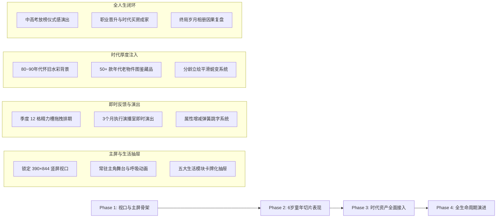

# 《1978—一生》游戏表现层全面重构与去网页化开发规范 (v2.0)

> **文档定位与使用说明**：
> 本文档是《1978—一生》彻底告别“网页后台管理系统（DOM 表单思维）”形态、全面升级为“确定性人生 Core + Phaser 2D 游戏表现层”的唯一开发总纲与执行基准文档。
> **严正澄清**：本项目是一款**中文竖屏季度回合制人生模拟游戏**（参考《中国式人生》游玩语法，以改革开放时代背景下的一生为核心），**绝非**地牢打怪、动作走位或砍怪游戏。后续所有系统开发、UI 改版、美术资产接入与体验验收均严格围绕本文档执行。

---

## 目录
- [一、 现状深度排查与“网页后台感”核心病灶诊断](#一-现状深度排查与网页后台感核心病灶诊断)
- [二、 四大核心问题专项整改方案](#二-四大核心问题专项整改方案)
  - [1. 画面与视口整改：锁定 390×844 竖屏标准视口，彻底消除网页滚动条](#1-画面与视口整改锁定-390844-竖屏标准视口彻底消除网页滚动条)
  - [2. 表现层架构整改：以 Phaser 2D 引擎替代原生 DOM，确立纯净分层边界](#2-表现层架构整改以-phaser-2d-引擎替代原生-dom确立纯净分层边界)
  - [3. 玩法表现与交互重塑：贯彻《中国式人生》游玩语法，打造真正的主人翁感](#3-玩法表现与交互重塑贯彻中国式人生游玩语法打造真正的主人翁感)
  - [4. AI 年代美术资产管线：老物件图鉴、时代背景与分龄角色立绘](#4-ai-年代美术资产管线老物件图鉴时代背景与分龄角色立绘)
- [三、 研发总纲与不可触碰红线 (Red Lines)](#三-研发总纲与不可触碰红线-red-lines)
- [四、 游戏感 (Game Juice) 强制感官验收清单](#四-游戏感-game-juice-强制感官验收清单)
- [五、 正式工程目录与技术契约](#五-正式工程目录与技术契约)
- [六、 启动与验证方式](#六-启动与验证方式)
- [七、 后续分阶段落地路线图 (Milestones)](#七-后续分阶段落地路线图-milestones)

---

## 一、 现状深度排查与“网页后台感”核心病灶诊断

当前《1978—一生》的可运行原型（位于 `public/index.html`）之所以给人“像在一个极小、局促的网页后台系统里点按钮、毫无游玩欲望”的糟糕体验，核心病灶在于**完全用开发“企业级后台管理系统（DOM 表单与表格思维）”的方式在写人生游戏**，缺乏真正的游戏舞台、视觉主角、即时动画反馈与时代沉浸感。

| 排查维度 | 现有 DOM 原型的“网页后台”病灶表现 | 真正的“人生模拟游戏”标准要求 | 严重程度 |
| :--- | :--- | :--- | :--- |
| **1. 视口与屏幕适配** | 局限在浏览器居中的一个窄小网页白板中，周围留白突兀，页面充斥原生滚动条与长文本拖拽光标。 | **390×844 竖屏高清标准游戏画布**（手机与 TapTap H5 首选，PC 自动等比居中并带氛围底色），锁死网页滚动条，支持一键沉浸全屏。 | ⭐⭐⭐⭐⭐（首要解决） |
| **2. 底层表现架构** | 原生 HTML `<div>` + `<button>` + 表单卡片堆叠，状态变化仅是 DOM 节点重新 innerHTML 替换。 | **Phaser 3 / Canvas 2D 独立渲染引擎驱动**，具备稳定的 60 FPS 动画帧循环、场景状态机、粒子图层与补间动效。 | ⭐⭐⭐⭐⭐ |
| **3. 舞台与角色沉浸** | 缺乏常驻主角形象，角色只是一串冷冰冰的数值（健康 65、智力 70）；无时代代入感。 | **屏幕上半部分常驻可见的角色动态形象**，立绘随年龄成长蜕变（襁褓婴儿 → 少先队红领巾 → 青年学子 → 职业人 → 退休长者），带有呼吸感与时代装束。 | ⭐⭐⭐⭐⭐ |
| **4. 生活行动与交互** | 网页式层层点击（选择行动后选项消失，到另一页二次确认提交），像在填写季度工作报表。 | **模块化生活抽屉/卡牌**（学校/活动/人际/家庭/资产），行动排入本季时间槽即时可见，**单次明确点击“推进本季”**，简单畅快。 | ⭐⭐⭐⭐⭐ |
| **5. 视觉与时代资产** | 纯 CSS 灰暗色块、系统黑体字、无插画或 Emoji 敷衍，缺乏 1978 改革开放以来的时代风貌。 | **接入 AI 年代游戏美术管线**：时代怀旧水彩场景插画、年代老物件卡牌（粮票、二八大杠自行车、黑白电视机、红白机、BP机、随身听）。 | ⭐⭐⭐⭐ |
| **6. 交互反馈 (Game Juice)** | 推进季度后屏幕瞬间闪变，只有死板的文字日志滚动，毫无视听正反馈与成就感。 | **丰富感官反馈**：行动点击有物理弹性下压与按压音效；属性成长有跳字动画；季度推进有 3 个月时钟推进剪影演出；重大里程碑全屏金边卡牌。 | ⭐⭐⭐⭐ |

---

## 二、 四大核心问题专项整改方案

### 1. 画面与视口整改：锁定 390×844 竖屏标准视口，彻底消除网页滚动条

* **全局清零边距与禁用文本选中**：
  在游戏宿主页面中强制锁定：
  ```css
  html, body {
      margin: 0;
      padding: 0;
      width: 100vw;
      height: 100vh;
      overflow: hidden;
      background-color: #101c22; /* 沉浸式暗墨绿底色，衬托竖屏舞台 */
      user-select: none;
      -webkit-user-select: none;
  }
  ```
* **逻辑基准分辨率（390×844，19.5:9 现代智能手机黄金比例）**：
  * 游戏内部坐标系统统一采用 `390×844` 进行绝对布局。
  * 在 PC 浏览器或高分屏下，通过 Phaser 引擎的 `Scale.FIT` 与 `autoCenter: CENTER_BOTH` 自动等比缩放居中展示，两侧展示优雅的时代花纹暗纹或暗色渐变，视口内部绝不允许出现任何横向或纵向网页滚动条。

---

### 2. 表现层架构整改：以 Phaser 2D 引擎替代原生 DOM，确立纯净分层边界

* **分层边界铁律（确定性人生 Core + Phaser 表现层）**：
  * **确定性 Core (`src/simulation/`, `src/game/`)**：纯纯粹粹的数据与逻辑模拟核心，保存 1978~2026 历史校准、出生概率、教育分支、职业账本、身体健康与跨年人际关系。**严禁读取任何 DOM、动画状态或素材路径**。
  * **Phaser 表现层 (`apps/game/src/`)**：负责渲染整个游戏视口、播放角色动作帧、绘制生活卡牌、播放数值跳动飘字与音效。**Phaser Scene 绝不直接篡改模拟事实**，所有操作均通过应用网关 `port.dispatch(command)` 提交确定性契约命令。
* **完整的 Phaser 场景状态机 (`apps/game/src/screens/`)**：
  1. `BootScene` / `PreloadScene`：环境探测、年代视觉资产与字体加载；
  2. `StartupScene` / `MainMenuScene`：1978 年代复古全屏片头、开始新人生与继承存档；
  3. `BirthScene`：出生时代档案、父母家庭背景、满岁抓周互动；
  4. `LifeScene`：【游戏核心主场景】包含常驻角色形象、六维属性雷达与精力槽、生活行动模块抽屉；
  5. `EventScene`：年代历史大事件、突发人际事件的插画剧场展示；
  6. `QuarterExecutionScene`：三个月生活动态推进演播室（展示人物相处、技能练习与事件打断）；
  7. `QuarterResultScene`：季度总结（属性飘字、兴趣萌芽、金钱消耗直观跳动）；
  8. `YearReviewScene`：Q4 增龄蜕变演出、年度家庭账本盘点与因果复盘。

---

### 3. 玩法表现与交互重塑：贯彻《中国式人生》游玩语法，打造真正的主人翁感

* **屏幕上半部：持续可见的“时代主人公舞台”**：
  * 角色不再是一行文字，而是屏幕上方核心焦点。
  * **分龄立绘平滑蜕变**：0~2岁襁褓与摇篮、3~5岁大院幼童、6~12岁戴红领巾与少先队臂章的小学生、15~18岁身穿宽大校服的中学生、青年职业装、成年西装/工装、晚年银发太极服。
  * 待机时拥有细腻的轻微呼吸微动 Tween（上下起伏 2~3 像素），根据心情状态显示不同表情（开心微笑、疲劳低落、生病发热）。
* **屏幕中下部：五大生活模块与时间槽可视化**：
  * 拒绝纯文字表单，收敛为直观可视的 5 个行动大类抽屉：
    1. **【学业/技能】**（课堂听讲、课外辅导、技能练习）
    2. **【日常活动】**（跳皮筋、捉迷藏、下棋、街头闲逛）
    3. **【社交关系】**（拜访玩伴、同伴相处、家庭陪伴、师长沟通）
    4. **【调养/休整】**（充足睡眠、强身健体、求医问药）
    5. **【家庭与资产】**（做家务、零花钱、兼职打工、房屋添置）
  * **行动留痕与单次推进**：玩家点击行动后，直接放入本季度底部的 12 格精力槽中，即时显示消耗与预期收益；界面只有一个明晃晃的 **“开启本季”** 推进大按钮，点一次即可观赏季度推进演出，严禁网页式反复确认。

---

### 4. AI 年代美术资产管线：老物件图鉴、时代背景与分龄角色立绘

* **统一时代美术基调**：
  * 采用 **20 世纪 80~90 年代中国现实主义与温暖复古水彩风格**，具备年代质感（搪瓷杯、水壶、大字报、红砖瓦房、大院走廊），拒绝廉价赛博或西方地牢奇幻风。
* **标准化 AI 资产生成 Prompt 规格库**：

| 资产类别 | 规格与尺寸 | 核心 Prompt 规范模板（复用生成） | 应用场景 |
| :--- | :--- | :--- | :--- |
| **时代生活背景** | `390×844` WebP/PNG | `Vintage Chinese residential courtyard in 1980s, red brick walls, bicycles parked, laundry hanging, warm afternoon sunlight, nostalgic watercolor illustration, anime game background, no characters, clean edges` | 作为 `LifeScene` 与事件的主屏背景 |
| **角色分龄立绘** | `300×420` 透明底 PNG | `Chinese boy aged 6 wearing school uniform with red scarf, holding textbooks, friendly smile, nostalgic anime character sprite, transparent background, isolated, clean outlines` | 常驻主舞台角色形象，随年龄切换 |
| **年代老物件图标** | `128×128` PNG | `Retro 1980s Chinese vintage object, a metal tin toy frog with clockwork key, soft studio lighting, clean icon style, game asset, transparent background` | 玩具、文具、证件、家电藏品图鉴 |
| **UI 材质与边框** | 九宫格纹理 PNG | `Vintage Chinese kraft paper texture, aged notebook border with red thread binding, subtle ink stains, flat UI frame element, clean vector feel` | 替代原生 HTML 灰框，打造怀旧手账质感 |

---

## 三、 研发总纲与不可触碰红线 (Red Lines)

1. **【严禁网页化】**：严禁出现任何类似企业后台系统的表格罗列、原生 `<button>` 素颜按钮、长篇纯文字滚动区域或网页式表单提交。
2. **【严禁偏离人生模拟】**：本项目是人生模拟与时代变迁游戏，**严禁添加任何地牢、打怪、角色移动、碰撞检测、寻路或动作游戏元素**。一切玩法围绕角色成长、亲友羁绊、时代抉择与人生复盘展开。
3. **【强制 390×844 竖屏 FIT 适配】**：游戏画布严格以 `390×844` 为基础，任何分辨率下不得出现原生滚动条与画面拉伸，PC 下保持居中并带氛围遮罩。
4. **【无反馈不上线】**：任何交互动作（选择行动、推进季度、获得金钱、改变关系）若无即时按压动效、音效、数值跳字或动画反馈，视为未完成功能。
5. **【尊重确定性模拟核心】**：所有随机与数值必须源自项目确定性 RNG 与因果模型，Phaser 表现层只能呈现 Core 发出的事件快照，严禁自行修改数值。

---

## 四、 游戏感 (Game Juice) 强制感官验收清单

后续每开发或改版一个人生模块，必须逐项通过以下 5 维感官体验验收：

1. **【行动点击弹性与留痕反馈】**：
   点击任意生活行动卡牌时，卡牌产生 `0.94x` 弹性下压与清脆纸张按压音效，随后以抛物线平滑飞入底部季度时间安排槽。
2. **【属性与数值动态跳字 (Floating Text)】**：
   季度结算或事件发生时：
   - 属性上升（如智力 +2）：绿色文字伴随 `1.3倍` 弹簧缩放向上浮现；
   - 属性下降（如压力 +10、健康 -5）：深红/橙色文字轻微下坠晃动；
   - 金币/精力消耗：数字伴随微小声效轻盈淡出。
3. **【季度推进 3 个月时钟与生活演出】**：
   点击“推进本季”后，屏幕呈现动态时钟齿轮或日历撕页动画，画面中央以剪影小动画展现这 3 个月的实际生活（如：坐在书桌前写作业、在大院里跳皮筋、在自行车后座上吹风），并在遇到随机突发事件时带轻微刹车顿帧与感叹号弹出。
4. **【重要人生里程碑全屏卡牌 (Milestone Cards)】**：
   在经历升学放榜、成人礼、第一份工作录用、拿到新房钥匙、婚礼仪式等重大时刻，屏幕调暗并以金色华丽翻转动画展开一张大尺寸年代专属插画纪念卡，支持长按截图保存。
5. **【角色生命呼吸感】**：
   常驻舞台的主角立绘处于待机时，带有柔和的垂直呼吸缩放补间（`scaleY: 1.02`，周期 2.4 秒）；点击角色身体会触发眨眼、挥手或头顶冒出当前心情气泡。

---

## 五、 正式工程目录与技术契约

本项目的正式技术架构严格解耦为 **确定性 Core** 与 **Phaser 表现层**：

```text
people-life/
├── apps/
│   └── game/                   # 【正式游戏前端工程 (Phaser 3 + Vite + TypeScript)】
│       ├── index.html          # 390x844 竖屏宿主页面 (锁定 100vw x 100vh)
│       ├── vite.config.ts      # 运行端口 4174
│       └── src/
│           ├── main.ts         # 游戏客户端入口与超采样高清配置
│           ├── contracts.ts    # 390x844 视口、RuntimeCommand、PresentationCue 契约
│           ├── runtime/        # 游戏运行时工厂 (create-game-runtime.ts) 与网关通讯
│           └── screens/        # 【核心游戏舞台场景群】
│               ├── boot-scene.ts            # 启动与无障碍模式校验
│               ├── preload-scene.ts         # 年代资产与字库预加载
│               ├── main-menu-scene.ts       # 1978 复古主菜单画面
│               ├── birth-scene.ts           # 出生、家庭档案与抓周仪式场景
│               ├── life-scene.ts            # 【核心】常驻主角舞台与生活模块主界面
│               ├── quarter-execution-scene.ts # 季度3个月执行演播室
│               ├── quarter-result-scene.ts  # 季度结算与成长跳字
│               ├── event-scene.ts           # 年代大事件与选择剧场
│               └── year-review-scene.ts     # Q4 增龄蜕变与年度账本
├── src/
│   ├── simulation/             # 【确定性模拟核心 (纯 TS/MJS，无 DOM，无 Phaser)】
│   │   ├── birth-generator.mjs # 1978~1982 出生档案生成器
│   │   ├── childhood-simulator.mjs # 0~6 岁生活轨迹
│   │   ├── primary-education-simulator.mjs # 小学教育
│   │   ├── adult-life-simulator.mjs # 成人职业与生活
│   │   └── ...
│   └── game/                   # 应用层网关 (game-engine.mjs, presenter.mjs)
├── public/                     # 静态资产与老旧 DOM 原型归档
│   ├── assets/                 # 实机美术资产 (年代背景、角色立绘、老物件)
│   └── index.html              # 旧 DOM 验证外壳 (仅供对比，严禁继续扩充)
└── docs/                       # 核心设计文档与执行台账
    ├── QUARTERLY_LIFE_SIMULATOR_MASTER_PLAN.md # 产品总纲基线
    └── PROJECT_DEVELOPMENT_STATUS.md           # 唯一开发台账
```

---

## 六、 启动与验证方式

### 1. 运行《1978—一生》正式 Phaser 表现层客户端 (推荐)
```powershell
npm run game:play
```
- 访问：**`http://127.0.0.1:4174`**
- 体验标准 390×844 竖屏游戏视口、出生立绘、抓周交互与季度流转。

### 2. 运行《1978—一生》旧 DOM 原型 (仅供对比验证)
```powershell
npm run play
```
- 访问：**`http://127.0.0.1:4173`**
- 用于回放与验证底层纯数据模拟。

### 3. 执行核心模拟与工程完整性校验
```powershell
npm run check
```
- 自动化执行 100,000 人次出生、成长与全生命周期因果链回放测试。

---

## 七、 后续分阶段落地路线图 (Milestones)



* **第一阶段（Phase 1：主屏舞台与生活抽屉重构）**
  * 在 `apps/game/src/screens/life-scene.ts` 中构建屏幕上半区常驻主角立绘舞台（带呼吸动效与表情气泡）。
  * 将生活行动彻底改造为 5 大卡牌化折叠抽屉，选择后行动在底部时间槽持续可见。
* **第二阶段（Phase 2：6 岁代表切片与即时反馈演出）**
  * 实装 `QuarterExecutionScene` 的 3 个月生活动态剪影与事件打断顿帧。
  * 实装 `VFXManager` 级别的属性跳字（数值弹簧缩放、金钱流动）。
* **第三阶段（Phase 3：AI 年代老物件与美术管线全面替换）**
  * 批量生成并接入 1978~1995 年代经典老物件（粮票、洋火、铁皮青蛙、随身听）。
  * 实装主角 0 岁、6 岁、12 岁、18 岁分龄立绘的平滑切换蜕变。
* **第四阶段（Phase 4：重大人生里程碑卡牌与全人生闭环）**
  * 打造高考放榜、首份工资发放、第一套房产红本、婚礼仪式等全屏仪式感纪念大卡。
  * 完成从出生到晚年的完整游戏表现层贯通，彻底废除旧 DOM 页面。
