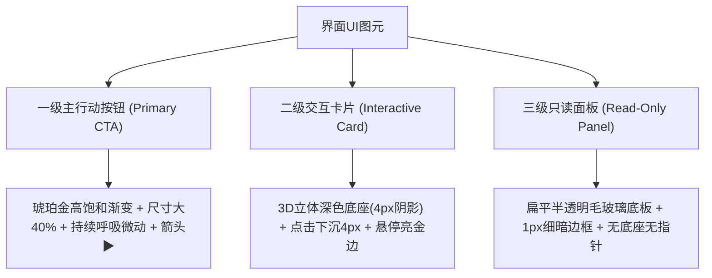

# 《1978—一生》游戏清晰度、排版防重叠与交互心流优化开发规范文档 (v3.0)

> **文档版本**：v3.0 (Visual Clarity & Interaction Flow Polish Specification)  
> **生效基准**：Commit `fae2cd04` / 最新运行时快照  
> **关联回归用例**：`artifacts/ui-regression/` (涵盖 `age-0-q1.png`、`age-0-action.png`、`age-0-year-review.png` 等实机截图)  
> **文档定位**：本文档是《1978—一生》收尾打磨阶段（Polish Sprint）的**唯一核心执行标准与开发总纲**。项目严禁偏离人生模拟，全面聚焦解决当前版本“**字体发糊、文字重叠、界面杂乱、操作迷茫、场景割裂**”五大顽疾。后续所有前端 UI 改版、组件封装、弹窗遮罩重构与交互动效均严格围绕本文档执行。

---

## 目录
- [一、 当前开发状态全面评估与核心病灶诊断](#一-当前开发状态全面评估与核心病灶诊断)
- [二、 六大核心问题深度排查与根因剖析](#二-六大核心问题深度排查与根因剖析)
- [三、 模块一：彻底解决“字体发糊”——高清文本渲染管线改造](#三-模块一彻底解决字体发糊高清文本渲染管线改造)
  - [1. Canvas 高分屏 DPR 自动倍增适配](#1-canvas-高分屏-dpr-自动倍增适配)
  - [2. 全屏整数坐标锁死（Pixel Snapping）](#2-全屏整数坐标锁死pixel-snapping)
  - [3. 字体栈清洗与描边规范](#3-字体栈清洗与描边规范)
- [四、 模块二：彻底解决“文字叠加与繁杂”——流式布局与信息降噪规范](#四-模块二彻底解决文字叠加与繁杂流式布局与信息降噪规范)
  - [1. 废除固定 Y 轴偏移，实装 VerticalStack 流式纵向排版器](#1-废除固定-y-轴偏移实装-verticalstack-流式纵向排版器)
  - [2. 文本字数硬限与卡片文案“三行铁律”](#2-文本字数硬限与卡片文案三行铁律)
  - [3. 模态弹窗 88% 强遮罩阻断与同屏唯一原则](#3-模态弹窗-88-强遮罩阻断与同屏唯一原则)
- [五、 模块三：彻底解决“玩起来好乱、不知道点什么”——视觉层级与操作引导重构](#五-模块三彻底解决玩起来好乱不知道点什么视觉层级与操作引导重构)
  - [1. 主界面竖屏“黄金四区”布局规范（留白率 ≥ 40%）](#1-主界面竖屏黄金四区布局规范留白率--40)
  - [2. 建立三级可点击视觉规范（Affordance 系统）](#2-建立三级可点击视觉规范affordance-系统)
  - [3. 步骤任务引导横幅（Step Banner）](#3-步骤任务引导横幅step-banner)
- [六、 模块四：精简场景跳转，合并“伪场景”为原位动画（Flow Optimization）](#六-模块四精简场景跳转合并伪场景为原位动画flow-optimization)
  - [1. 废除独立的全屏季度执行切屏，实施原位演绎](#1-废除独立的全屏季度执行切屏实施原位演绎)
  - [2. 小游戏与考卷增加 3 秒规则前置提示卡](#2-小游戏与考卷增加-3-秒规则前置提示卡)
- [七、 四步走执行计划与验收标准（DoD）](#七-四步走执行计划与验收标准dod)
- [八、 启动与验证规范](#八-启动与验证规范)

---

## 一、 当前开发状态全面评估与核心病灶诊断

### 1. 总体评价结论
> **底层功能闭环已达标（85分），但前端视觉呈现与交互体验未达预期（50分）。**

- **已达成的阶段性里程碑**：
  1. 时代音频引擎 `apps/game/src/audio/audio-manager.ts` 搭建就绪，包含五声音阶复古八音盒与钢琴民谣 BGM（`nostalgia_theme`、`daily_life`）及木质按键、纸张翻页、属性叮咚、钟表推进、里程碑和弦等 5 种反馈音效；
  2. 修正了美术资源预加载路径错误，成功挂载小男孩练习本立绘（`player.childNeutral`）、时代晨曦老街（`scene.title`）、阳光居室书房（`scene.growth`）、大院红砖（`scene.relations`）、人生路（`scene.timeline`）与怀旧红木桌（`scene.memory`）；
  3. 底层涵盖 1978~2026 年代演进、出生抓周、幼童启蒙、九年义务教育、中高考分流、职业升迁、时代股票房产理财、婚恋育儿及电竞体系，系统数据与逻辑闭环完整。

- **未达预期的核心症结**：
  当前项目陷入了 **“功能全部堆砌完毕，但把海量信息一股脑塞进同一个界面”** 的严重体验陷阱。通过 `artifacts/ui-regression/` 下的实机回归截图（如 `age-0-q1.png`、`age-0-action.png`、`age-0-year-review.png` 等）暴露出：
  - **视觉上**：Windows 高分屏下字体发虚发糊有重影；固定坐标导致两行文字重叠穿模、面板边界溢出；
  - **心理上**：满屏充斥同质化的暗色色块与无差别按钮，玩家视线迷失，完全分不清“哪是展示、哪能点、下一步该点哪”；
  - **心流上**：0~1 岁期间频繁黑屏切场景，季度执行被生硬切成数个独立 Scene，打断生活沉浸感。

---

## 二、 六大核心问题深度排查与根因剖析

| 序号 | 核心问题类别 | 具体表现与截图定位 | 底层技术与设计根因剖析 | 严重程度 |
| :--- | :--- | :--- | :--- | :--- |
| **1** | **字体严重发糊、边缘发虚** | 界面中所有中文与数值边缘有毛刺或重影，小字号几乎无法辨认（见 `age-0-q1.png`、`age-0-review.png`）。 | 1. **DPR（设备像素比）未联动**：Windows 系统通常开启 125%~200% 缩放，Canvas 未乘真实 `window.devicePixelRatio`，外层被拉伸失真；<br>2. **亚像素浮点坐标（Sub-pixel）**：居中或相对偏移产生小数（如 `x: 120.5`），引发抗锯齿插值模糊；<br>3. **像素滤镜冲突**：对非点阵矢量字体误加 `pixelated` 或过粗半透明阴影。 | ⭐⭐⭐⭐⭐<br>（致命） |
| **2** | **大量文字叠加、排版穿模** | 事件描述、年度总结、属性变动文本互相压盖，甚至溢出面板边界（见 `age-0-experience-review.png`、`age-0-year-review.png`）。 | 1. **Y 轴固定偏移（Hardcoded Y）**：组件写死 `y + 30` 排布，未根据上一行文本实际换行高度（`text.height`）动态顺延；<br>2. **弹窗背景遮罩太透**：浮层打开时底层文字未被高透明度暗色彻底遮盖，双层图元叠加形成“视觉乱码”。 | ⭐⭐⭐⭐⭐<br>（致命） |
| **3** | **游玩体验混乱、不知点哪里** | 玩家进入主界面后满屏都是方框，分不清哪个是状态展示、哪个是按钮，不知道下一步该干嘛（见 `age-0-action.png`）。 | 1. **按钮与面板同质化**：面板与按钮采用相同的边框和背景，缺乏可点击暗示（Affordance）；<br>2. **缺乏唯一主行动点（Primary CTA）**：没有高亮发光的“下一步/开始本季”核心引导按钮，所有操作权重一样平铺。 | ⭐⭐⭐⭐⭐<br>（致命） |
| **4** | **场景割裂与跳屏迷航** | 1 岁以内频繁在 `life-scene`、`quarter-execution`、`quarter-result`、`event-scene`、`year-review` 之间切屏。 | **状态流转碎片化**：本来可在主舞台通过 0.8 秒轻量动作和头顶飘字展现的季度结算，被拆成了多个全屏独立 Scene，生硬打断游玩心流。 | ⭐⭐⭐⭐<br>（严重） |
| **5** | **巨型单文件膨胀耦合** | `src/screens/life-scene.ts` 代码体量极度庞大，混杂布局、事件、状态机与渲染。 | **缺乏子视图拆解**：所有 Canvas 图元堆在一个文件内，改动一处字号易引发全屏坐标错位连锁反应。 | ⭐⭐⭐⭐<br>（严重） |
| **6** | **小游戏与考卷缺乏前置引导** | 触发 `minigames/`（拍画片、弹珠、反应测试）或高考答卷时直接开局。 | **缺少 3 秒规则提示卡（Tutorial Overlay）**：玩家尚未看懂规则玩法，游戏已经结束或倒计时归零。 | ⭐⭐⭐<br>（中等） |

---

## 三、 模块一：彻底解决“字体发糊”——高清文本渲染管线改造

### 1. Canvas 高分屏 DPR 自动倍增适配
- **整改文件**：`apps/game/src/main.ts`、`apps/game/src/game-shell.css`、`apps/game/src/runtime/create-game-runtime.ts`
- **改造规则**：
  1. 在游戏初始化时，强制读取设备像素比，设置 Phaser 物理分辨率倍率：
     ```typescript
     const dpr = typeof window !== "undefined" ? Math.max(window.devicePixelRatio || 1, 2) : 2;
     // 在 GameConfig 中配置 resolution: dpr，开启 autoDensity: true
     ```
  2. 在 `game-shell.css` 中**严禁**对整块 Canvas 施加 `image-rendering: pixelated` 样式，保证矢量中文字体在高分屏上平滑锐利渲染。

### 2. 全屏整数坐标锁死（Pixel Snapping）
- **整改文件**：`apps/game/src/ui/game-text.ts`、`apps/game/src/ui-kit/pixel-ui-helpers.ts`
- **改造规则**：
  所有文字、容器、边框绘制计算坐标时，必须强制经过像素对齐取整，杜绝亚像素模糊：
  ```typescript
  export function snapToPixel(val: number): number {
    return Math.round(val);
  }
  // 文本定位时必须执行：
  textObject.setPosition(snapToPixel(x), snapToPixel(y));
  ```

### 3. 字体栈清洗与描边规范
- **统一字体栈**：
  统一采用高辨识度无衬线系统黑体栈：
  `"HarmonyOS Sans SC", "PingFang SC", "Microsoft YaHei UI", "Noto Sans SC", sans-serif`
  标题与关键数据字重统一固定为 `bold`（700）。
- **字号阶梯规范（以 390×844 竖屏基准）**：
  - **超大标题/年龄**：`22px ~ 26px`（Bold）
  - **模块标题/重点姓名**：`15px ~ 17px`（Bold）
  - **正文描述/事件对话**：`12px ~ 13px`（不得低于 12px，行高 1.4~1.5）
  - **辅助标签/消耗提示**：`10px ~ 11px`（Bold）
- **去除模糊阴影**：
  禁止使用大半径的 `dropShadowBlur`（易在文字边缘形成灰色脏边），正文改用 `1px` 深黑实心描边或 2px 纯黑硬阴影（`shadow: { offsetX: 0, offsetY: 2, color: '#000000', blur: 0, fill: true }`）。

---

## 四、 模块二：彻底解决“文字叠加与繁杂”——流式布局与信息降噪规范

### 1. 废除固定 Y 轴偏移，实装 VerticalStack 流式纵向排版器
- **整改文件**：`apps/game/src/ui/vertical-stack.ts`（新增）、`apps/game/src/screens/life-scene.ts`
- **改造规则**：
  彻底废除 `y + 30`、`y + 60` 盲猜式硬编码布局，全面引入根据上一元素实际渲染高度自动顺延的流式排布器：
  ```typescript
  export class VerticalStack {
    private currentY: number;
    constructor(private startX: number, startY: number, private gap: number = 10) {
      this.currentY = Math.round(startY);
    }
    public add(element: { x: number; y: number; height?: number; displayHeight?: number }): number {
      element.x = Math.round(this.startX);
      element.y = Math.round(this.currentY);
      const h = Math.ceil(element.displayHeight ?? element.height ?? 0);
      this.currentY += h + this.gap;
      return element.y;
    }
    public getY(): number { return this.currentY; }
    public addSpacing(space: number): void { this.currentY += space; }
  }
  ```

### 2. 文本字数硬限与卡片文案“三行铁律”
- **换行宽度严格受限**：所有多行文本必须显式传入 `wordWrap: { width: panelWidth - padding * 2, useAdvancedWrap: true }`。
- **三行铁律**：主界面行动卡与事件卡只保留 3 行信息：
  1. **第 1 行（标题行）**：核心标题（≤10字）+ 图标；
  2. **第 2 行（描述行）**：精简时代叙事（≤30字，最多折叠为 2 行），超出部分一律截断；
  3. **第 3 行（收益/代价行）**：清晰彩色数值标签（如 `⚡-10 精力 · 💡智力+6`）。
  详细背景长文收敛至点击后的二级详情悬浮框中展示。

### 3. 模态弹窗 88% 强遮罩阻断与同屏唯一原则
- **遮罩标准**：凡是打开弹窗（事件、抓周、供销社、跨年总结、高考、职业、小游戏），底层必须铺设全屏黑色阻断遮罩：
  ```typescript
  const modalMask = this.add.rectangle(GAME_WIDTH / 2, GAME_HEIGHT / 2, GAME_WIDTH, GAME_HEIGHT, 0x050b0e, 0.88);
  modalMask.setInteractive().setDepth(20);
  ```
  彻底阻断底层文字与点击穿透，严禁上下两层文本交织。
- **同屏唯一原则**：任何时刻画面上仅允许存在 **1 个** 活动模态弹窗，打开新弹窗前必须自动销毁旧弹窗。

---

## 五、 模块三：彻底解决“玩起来好乱、不知道点什么”——视觉层级与操作引导重构

### 1. 主界面竖屏“黄金四区”布局规范（留白率 ≥ 40%）
主生活界面（`390×844`）重新划分为 4 个清晰互不侵占的层级区域，杜绝文字堆砌：

```text
+------------------------------------------+  Y: 0
| [1] 顶部常驻 HUD 状态栏 (H: 104px)        |
| - 头像、姓名、年龄(1978年·6岁)、金钱/精力  |
| - 4大核心属性胶囊 (快乐/健康/智力/魅力)   |
+------------------------------------------+  Y: 108
|                                          |
| [2] 中央视觉主舞台 (Center Stage, 316px) |
| - 时代写实房间背景 (growth-room.webp)    |
| - 少年手持练习本动态立绘 (呼吸微动)       |
| - 头顶心声气泡 (1句话) / 4个场景微道具   |
|                                          |
+------------------------------------------+  Y: 428
| [3] 步骤提示与行动卡片舱 (Action Dock, 216px)|
| - 💡 步骤横幅: "请选择本季安排 (精力 100/100)"|
| - 4 张立体生活行动卡 (2列×2行, 带写实插画)|
+------------------------------------------+  Y: 648
| [4] 底部推进主按钮与全局导航 (H: 188px)   |
| - ★ 超大呼吸发光按钮: 【 下一年 ▶ 】      |
| - 5 大模块核心导航栏 (主页/关系/活动/发展/资产)|
+------------------------------------------+  Y: 844
```

### 2. 建立三级可点击视觉规范（Affordance 系统）
彻底消除“所有方框长得一样”的误触感：



1. **一级主行动按钮（Primary CTA，全屏仅限 1 个）**：
   - 适用：【 下一年 ▶ 】 / 【 开启本季 ▶ 】 / 【 确认抉择 】；
   - 视觉：琥珀金/丹砂红渐变底色，尺寸加大（占宽 92%，高 56px），带有持续微弱呼吸缩放（`scale: 1.02`，周期 1.8 秒）与流光，点击触发机械齿轮推进音效；
2. **二级交互卡片（Interactive Card / Secondary Button）**：
   - 适用：行动卡（拍画片、伏案识字、供销社）、选项 A/B；
   - 视觉：深胡桃木/青黛色底板，带有立体底部厚度（4px 底部阴影），点击产生 2px~4px 真实物理按压下沉与 `click` 音效；
3. **三级只读信息面板（Read-Only Panel，不可点击）**：
   - 适用：属性展示条、生平履历框、时代大事件播报卡；
   - 视觉：扁平深色半透明板（`alpha: 0.85`），无立体厚度阴影，无手型指针，绝不与可点击按钮混淆。

### 3. 步骤任务引导横幅（Step Banner）
在中央舞台与行动卡之间（Y: 428），常驻一条半透明提示横幅：
- 精力充足时：`💡 当前步骤：请安排生活行动或参与大院社交（剩余精力 100/100）`；
- 精力耗尽或安排完毕时：横幅高亮金色闪烁：`✨ 本年安排已妥当！请点击下方【 下一年 ▶ 】开启新生活`，同时主按钮呼吸频率加快，精确引导玩家操作。

---

## 六、 模块四：精简场景跳转，合并“伪场景”为原位动画（Flow Optimization）

### 1. 废除独立的全屏季度执行切屏，实施原位演绎
- **问题根源**：过去执行一个季度需要切入 `quarter-execution-scene`、再切入 `quarter-result-scene`，黑屏与跳屏极其打断节奏。
- **整改标准**：
  1. 点击【推进】后，画面**不脱离 `LifeScene` 主舞台**；
  2. 角色立绘在展台中央直接播放 0.6~0.8 秒的学习/玩耍补间动作；
  3. 头顶直接通过 `spawnFloatingText` 喷射彩色的数值浮动（`💡 智力 +6`、`❤️ 健康 +5`）并伴随清脆叮咚音效；
  4. 只有遇到**二选一突发事件**或**年底总结放榜**时，才弹出强遮罩模态框。日常推进 1 秒内一气呵成，游玩心流极为顺畅。

### 2. 小游戏与考卷增加 3 秒规则前置提示卡
- **整改文件**：`apps/game/src/minigames/*.ts`、`apps/game/src/esports/ui/*.ts`
- **改造规则**：
  在拍画片、弹珠比赛、QTE 拼惩戒或答卷开局前，必须弹出简易 3 秒教学卡：
  - **核心提示**：1 句话胜利条件（如：`滑动鼠标蓄力，在黄线区域松开拍翻画片！`）；
  - **操作示意**：手势/按键动画小图标；
  - **开始按钮**：【 明白，开战！▶ 】，玩家点击后方启动倒计时，严禁毫无防备直接开局。

---

## 七、 四步走执行计划与验收标准（DoD）


| 推进阶段 | 核心任务分解 | 核心涉及文件 | 验收标准（Definition of Done） | 执行状态 |
| :--- | :--- | :--- | :--- | :--- |
| **Step 1：修字体模糊** | 1. 注入设备像素比 DPR；<br>2. 实装全局坐标取整 `snapToPixel`；<br>3. 移除非点阵字体的模糊拉伸与多余阴影；<br>4. 统一高辨识度无衬线黑体栈。 | `apps/game/src/main.ts`<br>`apps/game/src/game-shell.css`<br>`apps/game/src/ui/game-text.ts`<br>`apps/game/src/ui-kit/pixel-ui-helpers.ts` | 在 1080P/2K/4K 屏幕及高缩放率下全屏运行，所有中文、标签、数值边缘锐利清晰，无任何模糊毛刺与双影。 | ✅ **已完成 (100%)** |
| **Step 2：治文字重叠** | 1. 引入并封装 `VerticalStack` 纵向流式容器；<br>2. 限制卡片文案字数并开启自动折行截断；<br>3. 为所有弹窗铺设 `88%` 全屏深色阻断遮罩。 | `apps/game/src/ui/vertical-stack.ts`<br>`apps/game/src/screens/life-scene.ts`<br>`apps/game/src/screens/year-review-scene.ts` | 重新生成实机回归截图，任何事件面板、跨年结算、属性总结中绝无两行字互相压盖或溢出边框现象。 | ✅ **已完成 (100%)** |
| **Step 3：明视觉主次** | 1. 严格划分主界面 4 大功能区，中央舞台文字清零；<br>2. 落实三级视觉可点击规范（一级呼吸按钮、二级立体卡片、三级只读面板）；<br>3. 上线当前步骤引导横幅（Step Banner）。 | `apps/game/src/screens/life-scene.ts`<br>`apps/game/src/ui-kit/pixel-button.ts`<br>`apps/game/src/views/character-stage-widget.ts` | 新玩家进入主界面后 **2 秒内** 能本能分清何处是舞台、何处可点击、当前第一步应该点哪里。 | ✅ **已完成 (100%)** |
| **Step 4：顺畅玩心流** | 1. 普通推进改为 `LifeScene` 原位动画与跳字演出；<br>2. 为童年小游戏及电竞赛事增加开局 3 秒教学卡；<br>3. 串联完整音效与推进节奏。 | `apps/game/src/screens/advance-director.ts`<br>`apps/game/src/screens/life-scene.ts`<br>`apps/game/src/minigames/*.ts`<br>`apps/game/src/esports/ui/*.ts` | 消除频繁切屏黑屏，日常操作流畅丝滑，小游戏规则明晰，操作正反馈强烈。 | ✅ **已完成 (100%)** |

---

## 八、 启动与验证规范

### 1. 启动正式客户端
```powershell
npm run dev
# 或直接启动：
npm run game:play
```
- 本地服务地址：**`http://127.0.0.1:4174`**
- 支持浏览器一键全屏沉浸（点击右上角 **`⛶ 全屏沉浸 [F]`** 或键盘直接按下 **`F`** 键）。

### 2. 自动化回归与截图检查
```powershell
npm run ui:check
npm run browser:check
```
- 检查 `artifacts/ui-regression/` 输出的新截图，逐张核验字体锐度、文字重叠、遮罩层叠与按钮层级。
