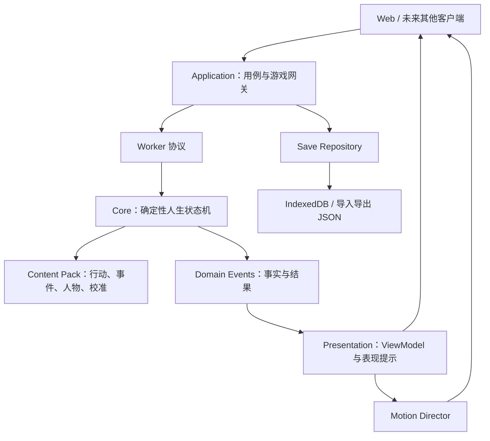

# 《1978—一生》技术架构

状态：已决定，后续开发默认遵循。  
适用范围：Web 原型、最终 TapTap H5 小游戏、PWA、未来 Android/iOS 封装，以及可复用同一模拟核心的其他客户端。

## 1. 架构目标

这是一款以文字选择、季度行动、人物关系和长期因果为主的模拟游戏，不需要为了少量动画引入完整 2D/3D 游戏引擎。技术架构首先保证：

1. 同一种子和同一串玩家命令始终产生同一人生结果；
2. 模拟规则不读取 DOM、浏览器存储、动画或具体页面；
3. 历史校准数据、虚构玩法内容和程序规则保持可辨认；
4. 新增人物、事件、行动和美术时，不需要继续扩大单个界面文件；
5. 长人生不在每次点击后从出生完整重算；
6. 动画可以跳过、关闭或替换，不改变任何模拟结果；
7. Web、手机壳和未来其他客户端可以复用模拟核心与内容包。

## 2. 已确定技术栈

| 层 | 选择 | 不选择/暂缓 |
| --- | --- | --- |
| 语言 | TypeScript 严格模式 | 继续扩大无类型的 `.mjs` 接口 |
| Web 构建 | Vite | 自写静态文件拼装长期扩张 |
| UI | Vue 3、Composition API、单文件组件 | 把所有页面继续写进 `public/app.mjs` |
| 页面导航 | Hash 路由；迁移后由 Vue Router 接管 | 页面状态写入模拟存档 |
| 游戏核心 | 纯 TypeScript 状态机、命令驱动、确定性随机 | Vue store 直接修改人生状态 |
| 后台计算 | Web Worker，通过类型化消息协议通信 | UI 主线程承担整生重放 |
| 正式存档 | IndexedDB；设置项可继续使用 localStorage | 把越来越大的完整人生塞入 localStorage |
| 内容 | JSON 源文件 + Schema 校验 + 构建时内容包 | 页面代码内硬编码事件 |
| 美术 | SVG、透明 WebP/PNG、CSS 图层 | 目前引入 Unity、Godot、PixiJS |
| 动画 | CSS Transition/Animation + Web Animations API | 动画回调直接改变属性或随机结果 |
| 自动测试 | 现有 Node 批量模拟 + 类型检查 + 浏览器回归 | 只靠人工点击测试 |
| 主发布 | TapTap H5 小游戏；普通 Web/PWA 用于开发和外部测试 | 为首发重写 Canvas 小游戏客户端 |
| 后续独立移动包 | 验证留存后再用 Capacitor 生成 Android 和 iOS 包 | 现在维护独立 Android/iOS 业务代码 |

Vue 官方建议完整应用采用 Composition API 与单文件组件，且官方脚手架直接提供 Vite 与 TypeScript；Vite 可以把 Worker 编译为独立产物。Capacitor 只作为 Web 客户端成熟后的可选原生容器，不进入模拟核心。

## 3. 总体结构



依赖方向只能从外向内。`core` 不允许反向导入 `application`、`presentation`、`platform` 或 `apps`。

## 4. 目标目录

项目逐步迁移为 npm workspaces；不一次性移动全部现有文件。

```text
apps/
  web/                       Vue 页面、路由和样式
  taptap-h5/                复用 web 构建，仅放 TapTap 平台启动与能力适配
  native-shell/              可选 Capacitor 配置，不放业务规则
packages/
  contracts/                 跨层 TypeScript 类型和协议
  core/                      RNG、状态机、阶段模拟和领域事件
  application/               开始人生、提交命令、读写存档
  content/                   JSON Schema、加载、校验和内容版本
  presentation/              页面 ViewModel、文案格式化、表现提示
  platform-web/              IndexedDB、下载、浏览器能力
  ui-kit/                    卡片、选项、数值条、人物卡等组件
data/
  calibration/               有来源的历史校准数据
  gameplay/                  虚构场景、行动、人物角色和玩法内容
art-source/                  可编辑原稿，不打入发布包
public/assets/               经过压缩、由 manifest 引用的发布素材
scripts/                     批量模拟、内容检查、构建和回归
docs/                        系统规则、架构和美术规范
```

当前 `src/simulation` 视为未来 `packages/core` 的来源；`game-application` 是未来 application 层雏形；`presenter` 和 `page-presenter` 迁入 presentation；`browser-platform` 迁入 platform-web。

## 5. 核心协议

### 5.1 玩家命令

UI 只提交命令，不直接修改快照：

```ts
type GameCommand =
  | { type: "life.start"; config: StartLifeConfig }
  | { type: "quarter.plan"; eventId: string; activityIds: string[] }
  | { type: "event.choose"; eventId: string; optionId: string }
  | { type: "year.confirm"; year: number }
  | { type: "debug.advance"; target: DebugTarget };
```

命令包含稳定 ID，不包含页面元素、显示顺序或中文文案。

### 5.2 引擎回复

```ts
interface EngineReply {
  snapshot: GameSnapshot;
  pending: PendingDecision | null;
  domainEvents: DomainEvent[];
  checkpoint?: SaveCheckpoint;
  diagnostics?: EngineDiagnostics;
}
```

`DomainEvent` 是已经发生的游戏事实，例如 `quarter.settled`、`interest.changed`、`person.met`、`year.advanced`。界面不能根据动画是否完成决定这些事实是否生效。

### 5.3 表现提示

presentation 层把领域事件映射为可丢弃的提示：

```ts
interface PresentationCue {
  id: string;
  type: "scene.enter" | "choice.resolve" | "stat.delta" |
        "relationship.change" | "year.advance" | "chapter.complete";
  priority: "ambient" | "normal" | "key";
  payload: Record<string, unknown>;
}
```

表现提示不写入确定性命令日志。跳过动画、刷新页面或开启“减少动态效果”时，人生结果完全不变。

## 6. 从整生重放改为增量状态机

当前引擎通过“种子 + 全部选择”从出生重放，优点是容易验证确定性，缺点是人生越长，每次点击越慢。迁移使用绞杀式替换：

1. 先建立 `GameGateway`，现有实现命名为 `ReplayGameGateway`；
2. Vue 页面只依赖网关，不依赖具体模拟器；
3. 新建 `IncrementalGameGateway`，一次只推进到下一个等待节点；
4. 每个自然年结束生成 checkpoint，关键阶段结束额外生成 checkpoint；
5. 命令日志用于复核与“没有走过的道路”，checkpoint 用于快速继续；
6. 调试器仍可以从出生重放，用于确定性验收；正式游玩默认从最近 checkpoint 增量推进；
7. 稳定后把增量网关放入 Worker，UI 只接收结构化克隆结果。

两种网关在迁移期必须通过同一组“同命令同快照”契约测试，之后才能移除重放网关的正式运行职责。

## 7. 存档结构

正式存档升级时使用新的 schema 版本，保留 v4 导入：

```ts
interface LifeSave {
  schemaVersion: number;
  engineVersion: string;
  contentVersion: string;
  seed: string;
  commandLog: GameCommand[];
  latestCheckpoint: SaveCheckpoint;
  completedLifeSummary?: CompletedLifeSummary;
  savedAt: string;
}
```

规则：

- IndexedDB 保存正式人生、调试人生和人生画廊；
- localStorage 只保留音量、动画强度、当前路由等小设置；
- 每个存档同时记录 `engineVersion` 与 `contentVersion`；
- 不保存可重新生成的 ViewModel；
- 支持导出/导入 JSON 与迁移预览；
- 写入采用临时记录后替换正式记录，避免中途关闭造成半份存档；
- 存档迁移只能补字段或转换结构，不能暗中重新抽取人生结果。

## 8. 内容架构

内容源分为三类：

1. `calibration`：带来源的历史数据；
2. `gameplay`：虚构人物、场景、行动和事件文案；
3. `rules`：公式、阈值、冷却、选择条件和状态变化。

构建流程：

```text
JSON 源文件 → JSON Schema 校验 → 交叉 ID 检查 → 内容版本哈希
→ content.pack.json → Core 只读加载
```

所有人物、行动、选项、事实和素材使用稳定 ID。内容不能通过文件路径或中文标题互相引用。历史观测、模型假设、未来情景和纯玩法文案继续分别标识。

## 9. 页面组件边界

Web 客户端按页面和领域组件拆分：

```text
views/
  TitleView.vue
  NewLifeView.vue
  LifeView.vue
  GrowthView.vue
  RelationsView.vue
  TimelineView.vue
  ArchiveView.vue
  EventFlowView.vue
  QuarterResultView.vue
  YearReviewView.vue
  EndingView.vue
components/
  game/ActionPool.vue
  game/LifeMainline.vue
  game/QuarterProgress.vue
  game/ChoiceCard.vue
  game/PersonCard.vue
  game/CausalChain.vue
  art/SceneBackdrop.vue
  art/CharacterPortrait.vue
  motion/MotionLayer.vue
```

约束：页面不计算模拟公式；组件不直接读取存档；文案格式化不散落在模板；一个组件超出约 300 行时优先按职责拆分。

## 10. 平台与发布

开发和封闭测试形态继续是响应式 Web/PWA，最终主发布形态确定为 TapTap H5 小游戏。`apps/taptap-h5` 复用相同 Vue 页面和构建产物，只增加 TapTap 登录、云存档、分享、生命周期等平台适配，平台 API 不得进入 core。

验证留存以后，如需 Android 下载包或 App Store 独立 iOS 版，再加入 Capacitor；如需 Steam，则另建桌面发布适配，不改变模拟核心。若以后制作不兼容 DOM 的其他客户端，只实现新的 UI、platform 和 GameGateway 传输层；`contracts`、`core`、`content` 与大部分 presentation 保持复用。

服务器在单机 MVP 中不是必需。排行榜、云存档、账号和付费真正进入范围后，再增加后端；不能为了“以后可能用”提前把确定性单机模拟改成联网依赖。

## 11. 质量门槛

每次架构迁移必须满足：

- `core` 中不存在 `window`、`document`、`localStorage`、Vue 或素材路径；
- 同种子、同内容版本、同命令日志产生相同快照；
- 内容 ID 和素材 manifest 在构建时全部可解析；
- v4 真实存档样例能迁移且关键事实不改变；
- Worker 与主线程网关通过同一契约测试；
- 动画关闭后全部操作仍可完成；
- 390px 手机宽度无横向滚动；
- 关键选择、季度结算、年度结算和存档写入均有浏览器回归；
- 批量人口校准结果在允许误差内保持稳定。

## 12. 迁移顺序

### A. 架构地基

- 建立 workspaces、TypeScript、Vite、Vue 和类型检查；
- 添加 contracts、GameGateway、SaveRepository 与 AssetManifest 接口；
- 用 ReplayGameGateway 包住当前引擎，行为不得变化。

### B. 页面迁移

- 先迁移流程页，再迁移五个主页面；
- 每迁一页都保留现有浏览器回归；
- `public/app.mjs` 最终只剩启动兼容代码并被移除。

### C. 存档与内容

- IndexedDB repository、v4→v5 迁移和 JSON 导入导出；
- 建立 Schema、内容构建和素材 manifest。

### D. 增量引擎

- 加 checkpoint、命令协议和增量推进；
- 对照 ReplayGameGateway 验证后接入 Worker。

### E. 美术与动画

- 接入场景背景、人物剪影、关键事件插图和 Motion Director；
- 加动画强度、跳过和减少动态效果；
- 最后再评估音效和音乐，不让它阻塞核心玩法。

## 13. 官方参考

- Vue TypeScript：https://vuejs.org/guide/typescript/overview
- Vue Composition API：https://vuejs.org/guide/introduction
- Vite Worker：https://vite.dev/guide/features.html#web-workers
- IndexedDB：https://developer.mozilla.org/en-US/docs/Web/API/IndexedDB_API
- Web Workers：https://developer.mozilla.org/en-US/docs/Web/API/Web_Workers_API
- Capacitor：https://capacitorjs.com/docs
- TapTap H5 小游戏：https://developer.taptap.cn/minigameapidoc/quick-start/guide/minigames-intro/
