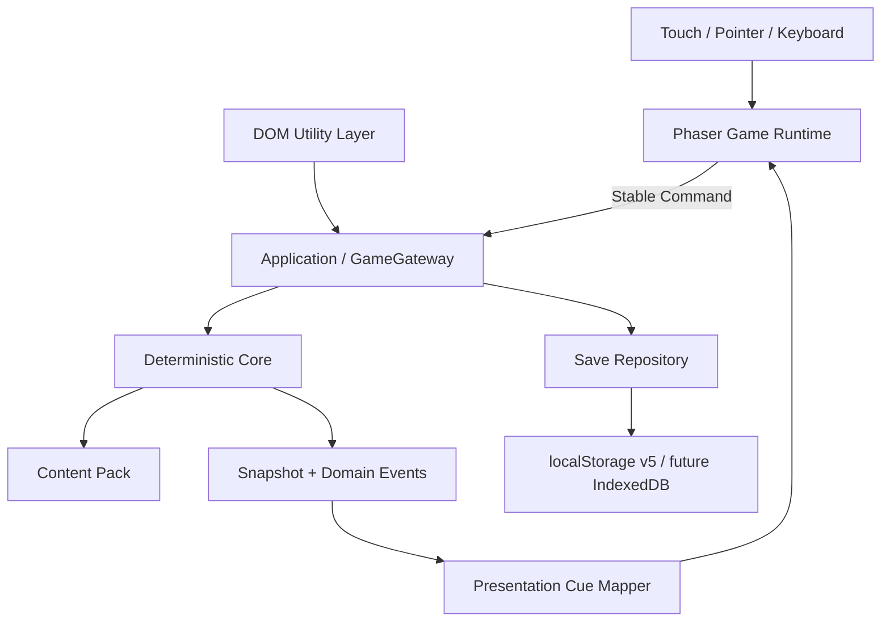

# 《1978—一生》技术架构 v2.0

状态：**游戏优先架构已冻结；后续正式表现层按本文渐进迁移**

生效日期：2026-08-24

适用范围：本地开发、TapTap H5、未来 Web/PWA 或其他复用同一模拟 Core 的客户端

## 1. 架构结论

《1978—一生》是 2D 竖屏季度回合制人生模拟游戏，不是网页表单或信息仪表盘。

正式架构冻结为：

```text
Deterministic Core
  → Application / GameGateway / Save
  → Domain Events + Snapshot
  → Presentation Cue Mapper
  → Phaser/Canvas 2D Game Runtime
  → DOM Utility Layer（仅设置、长记录、调试、导入导出和可访问性）
```

浏览器和 TapTap H5 只是运行容器。使用 HTML、CSS、JavaScript 或 TypeScript 不会自动把产品变成网页；把主玩法继续写成 DOM 页面、滚动卡片和二次确认表单，才会使它退化为网页。

当前 `public/index.html`、`public/app.mjs`、`public/styles.css` 是遗留原生 ESM/DOM 原型。它们已经证明 Core、路由、存档和调试可以运行，但不代表正式游戏运行时已经完成。从本规范生效起，这三个文件只允许启动兼容、迁移桥接和必要缺陷修复，不再承载新增主玩法。

## 2. 不可破坏的系统资产

以下能力继续保留并通过适配层复用，不做一次性重写：

- `src/simulation/` 的确定性人生模拟；
- 项目确定性 RNG、稳定 action/event/person ID；
- 每季度三个月实际执行、事件中断和资源约束；
- 兴趣、关系、共同记忆、长期因果和未走道路；
- `GameGateway`、命令校验、存档迁移、恢复和调试回放；
- 内容与历史校准数据分层；
- 现有 Node 批量模拟和确定性检查。

同一种子、同一内容版本和同一命令序列必须产生相同人生事实。更换游戏运行时、跳过动画、静音或刷新页面都不能改变模拟结果。

## 3. 正式技术栈

| 层 | 冻结选择 | 禁止继续采用的主路线 |
| --- | --- | --- |
| 语言 | TypeScript 严格模式；现有 `.mjs` 渐进适配 | 继续扩大无类型的跨层接口 |
| 构建 | Vite | 长期手写静态文件拼装 |
| 2D 主运行时 | Phaser 3.90，Canvas/WebGL 自动选择 | 用 DOM 卡片承担角色、季度和事件主玩法 |
| 模拟核心 | 渲染器无关的纯状态机、稳定命令、确定性随机 | 在 Phaser Scene 或 UI 回调中计算人生事实 |
| 表现 | Snapshot/DomainEvent → PresentationCue → Scene Director | 动画回调直接改属性、关系、现金或 RNG |
| DOM 工具层 | 设置、长记录、调试、存档导入导出、可访问性入口 | 把 DOM 工具层扩成主游戏舞台 |
| 内容 | JSON + Schema + 稳定 ID + 内容版本 | 在 Scene、HTML 或中文标题里硬编码事实关联 |
| 美术 | manifest 管理的 WebP/PNG/SVG、序列帧/精灵、UI 图集 | 让素材文件名成为公共协议 |
| 存档 | 当前 v5 保持兼容；正式迁移后评估 IndexedDB | 保存 Phaser 对象、DOM 节点或动画状态 |
| 发布 | TapTap H5 首发，普通浏览器用于开发与验证 | 因为是 H5 就把产品继续做成网页应用 |

本项目不需要 3D、自由移动、地图、热点、寻路、碰撞或物理系统。采用 Phaser 是为了游戏屏幕生命周期、显示列表、Tween、输入、音频、资源和表现编排，不是重新引入已否定的轻场景探索方向。

## 4. 分层依赖



依赖只能从外向内：

- Core 不读取 `window`、`document`、localStorage、Phaser、素材路径、动画或当前屏幕；
- Application 负责命令、决策节点、存档和恢复，不负责画面；
- Presentation 只把既成事实映射为可丢弃的 cue，不产生游戏事实；
- Phaser Scene 只显示快照、接收输入、提交命令和播放 cue；
- DOM 工具层与 Phaser 使用同一个 GameGateway，不能另建一套人生状态；
- 任何层都不得使用 `Math.random()` 影响游戏事实。

## 5. 目标目录

采用渐进迁移，不要求一次移动全部现有文件：

```text
apps/
  game/                         Vite + Phaser 正式游戏入口
  taptap-h5/                   TapTap 生命周期、登录、分享和云存档适配
packages/
  contracts/                   命令、快照、cue、存档、素材 manifest 类型
  core/                        现有 src/simulation 的渐进目标
  application/                 GameGateway、用例、存档协调
  presentation/                DomainEvent → PresentationCue
  game-runtime/
    boot/                      Phaser 配置、缩放、资源预加载
    screens/                   Title、Life、Event、QuarterResult、YearReview、Ending
    hud/                       年龄、季度、身份、资源、单一推进动作
    actions/                   模块、行动、季度安排、资源不足反馈
    actors/                    玩家与持续人物的头像/姿态/状态表现
    motion/                    Tween、转场、月份/季度/增龄演出
    audio/                     UI、事件与环境音
  dom-utility/                 设置、记录、调试、导入导出、可访问性
  platform-web/                存储、下载、浏览器能力
data/
  calibration/                有来源的历史观测
  gameplay/                   虚构人物、行动、事件和玩法内容
public/assets/                 仅由 manifest 引用的发布素材
scripts/                      模拟、内容、构建、浏览器和发布检查
```

目录名可在实施时按现有工程逐步落地，但职责边界不得改变。

## 6. 命令、回复与表现 cue

UI 和 Phaser 只能提交稳定命令：

```ts
type GameCommand =
  | { type: "life.start"; config: StartLifeConfig }
  | {
      type: "quarter.plan";
      eventId: string;
      allocations: Array<{
        actionId: string;
        intensity: "trial" | "regular" | "focus";
      }>;
    }
  | { type: "event.choose"; eventId: string; optionId: string }
  | { type: "year.confirm"; year: number }
  | { type: "debug.advance"; target: DebugTarget };
```

```ts
interface EngineReply {
  snapshot: GameSnapshot;
  pending: PendingDecision | null;
  domainEvents: DomainEvent[];
  checkpoint?: SaveCheckpoint;
  diagnostics?: EngineDiagnostics;
}
```

```ts
interface PresentationCue {
  id: string;
  type:
    | "screen.enter"
    | "action.scheduled"
    | "action.resolve"
    | "resource.delta"
    | "person.react"
    | "event.interrupt"
    | "month.advance"
    | "quarter.complete"
    | "year.advance";
  priority: "ambient" | "normal" | "key";
  payload: Record<string, unknown>;
}
```

cue 不进入确定性命令日志。动画跳过或刷新时，运行时必须直接重建为最新已保存事实。

## 7. 游戏屏幕和交互边界

正式主游戏由少量游戏屏幕组成：

- `TitleScreen`：继续/新人生；
- `LifeScreen`：角色、年龄、季度、资源、近期人生记录、生活模块和当前季度安排；
- `ActionPanel`：具体行动、对象、成本、风险和状态；
- `EventScreen`：事件发生、选择和人物反应；
- `QuarterResultScreen`：三个月过程、执行率、资源与因果；
- `YearReviewScreen`：Q4 回望、增龄和下一年龄入口；
- `EndingScreen`：关键人生片段与因果复盘。

DOM 工具页：

- 设置；
- 可展开的长记录/计算解释；
- 调试台；
- 存档导入导出；
- Canvas 等价可访问性入口。

交互硬规则：

1. 角色、年龄、季度、身份和核心资源持续可见；
2. 学校/活动/关系/家庭/生活等模块是游戏菜单，不是网站页面；
3. 点击行动后，行动以令牌、图标或明确条目留在本季度安排中，不得消失；
4. 行动选择立即显示输入、成本、人物或状态反馈，但最终事实以 Core 结算为准；
5. 每季度只保留一个明确的结束/推进动作；
6. 资源不足必须给出可理解的缺口和可返回调整的路径；
7. 事件打断、三个月推进、季度结算和 Q4 增龄必须有可观察的状态变化与转场；
8. 不使用自由移动、地图、隐藏热点或背景猜点击来承载行动。

## 8. 素材与表现

- 全部素材通过稳定 manifest key 访问，不由业务代码拼路径；
- 按 `actors`、`ui`、`events`、`backgrounds`、`fx`、`audio` 分组；
- 首包只加载当前年龄和当前屏幕需要的资源；
- 动画、声音和震动只消费 cue，可关闭、可跳过；
- 支持 `prefers-reduced-motion` 和游戏内完整/减少/关闭设置；
- 图片或音频失败时不得阻断命令、存档或下一季度；
- 概念图不能直接宣称为最终实机资产。

## 9. 存档边界

当前 v5 存档继续作为迁移输入。正式存档只保存可序列化的模拟事实和命令，不保存：

- Phaser Scene、GameObject、Tween、Texture 或 Camera；
- DOM 节点、CSS class、当前动画帧；
- 可由快照重建的 ViewModel；
- 未经 Core 确认的属性或关系结果。

迁移到 IndexedDB 只在包体、存档数量或生命周期证据证明有必要时实施。任何 schema 升级都必须有旧存档样例、迁移检查和结果不变证据。

## 10. 渐进迁移顺序

### A. 游戏壳与协议

- 建立 Vite/TypeScript/Phaser 正式入口；
- 冻结 GameGateway、GameCommand、EngineReply、PresentationCue 和 AssetManifest；
- 先接现有 ReplayGameGateway，不改模拟事实；
- 旧 DOM 入口保持可运行，作为对照与回退，不继续加主玩法。

### B. 1984 年 6 岁 Q1 灰盒

- 只做 `LifeScreen`、四至五个模块、行动留痕、单一季度推进；
- 接入资源不足、事件打断、月份推进和结果 cue；
- 在 Chrome 390×844 录制 60～90 秒无剪辑流程；
- 若仍主要表现为滚动文字、卡片和表单，停止扩内容，先修正游戏交互。

### C. Q1～Q4 垂直切片

- 接入现有年龄 6 内容、三名持续人物和六个事件；
- 完成 Q4 年度回望、7 岁入口、存档恢复；
- 检查普通路径、资源受限路径和事件中断路径。

### D. 工具层与替换

- 把记录、设置、调试和导入导出迁入 DOM Utility Layer；
- 删除对旧 `public/app.mjs` 主生活渲染的正式依赖；
- 更新 H5 构建，让 Phaser 与正式 manifest 进入发布包；
- 只有全部回归通过后才移除遗留 DOM 主屏。

### E. 后续年龄与性能

- 按 18、30、45、65 岁代表切片验证后再扩全人生；
- 有真实性能证据后再引入 Worker、增量网关或更复杂缓存；
- 不用架构迁移代替玩法验证。

## 11. 质量门槛

架构或游戏表现改动必须满足：

- Core 无 DOM、Phaser、浏览器存储和素材依赖；
- 同种子、同内容版本、同命令日志产生相同快照；
- Phaser 运行时不直接写模拟事实；
- 内容 ID 和素材 manifest 全部可解析；
- 当前真实 v5 存档能恢复，升级时有迁移检查；
- 动画关闭和 reduced motion 下可以完整操作；
- 390×844 无横向溢出、遮挡和不可达按钮；
- Chrome 实机流程覆盖资源不足、事件打断、Q4 增龄和存档恢复；
- UI/交互改动运行 `npm run ui:check` 与 `npm run browser:check`；
- 公共模拟、命令、RNG 或存档改动运行 `npm run check`；
- 60～90 秒无剪辑流程能够让产品负责人看见角色状态、行动留痕、即时反馈、时间推进和结果变化；能启动、背景图或文字卡不算完成。

## 12. 发布边界

TapTap H5 复用同一游戏运行时和模拟 Core，只新增平台生命周期、账号、云存档、分享或审核适配。平台 API 不得进入 Core。单机 MVP 不提前增加后端、支付、广告或排行榜。

微信小游戏不是当前首发范围。未来若产品负责人正式改为微信优先，再单独比较 Phaser 适配与 Cocos Creator 迁移成本；不能因为参考《中国式人生》就复制它的平台或工程结构。

## 13. 参考

- Phaser：https://docs.phaser.io/
- Vite：https://vite.dev/
- IndexedDB：https://developer.mozilla.org/en-US/docs/Web/API/IndexedDB_API
- Web Workers：https://developer.mozilla.org/en-US/docs/Web/API/Web_Workers_API
- TapTap H5 小游戏：https://developer.taptap.cn/minigameapidoc/quick-start/guide/minigames-intro/
