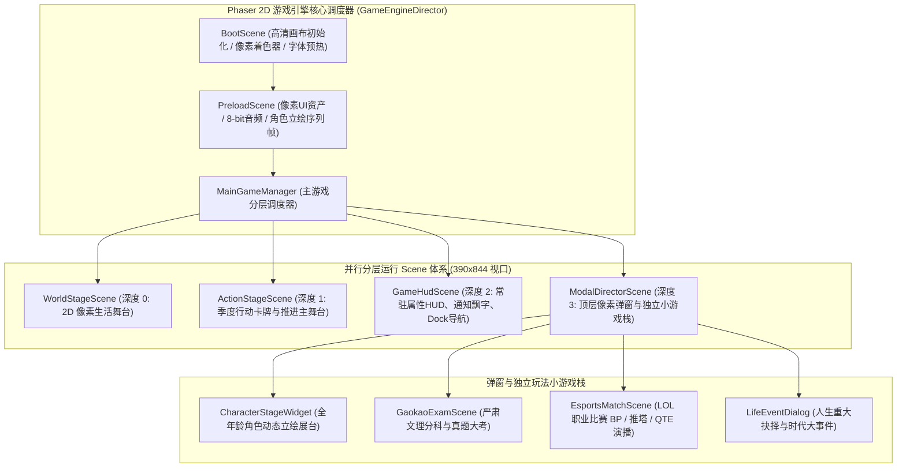
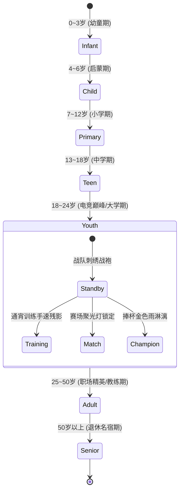
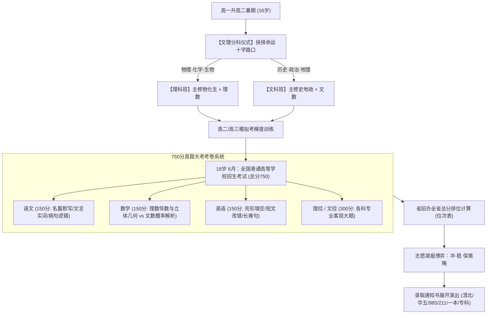
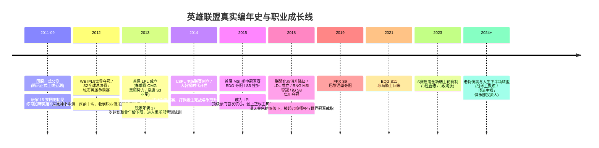
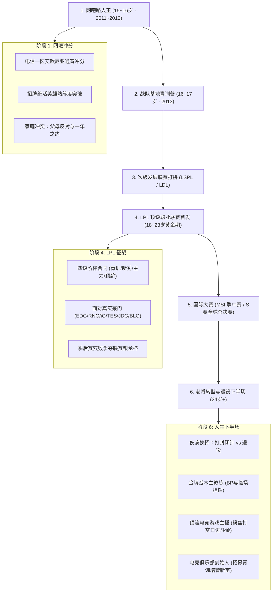
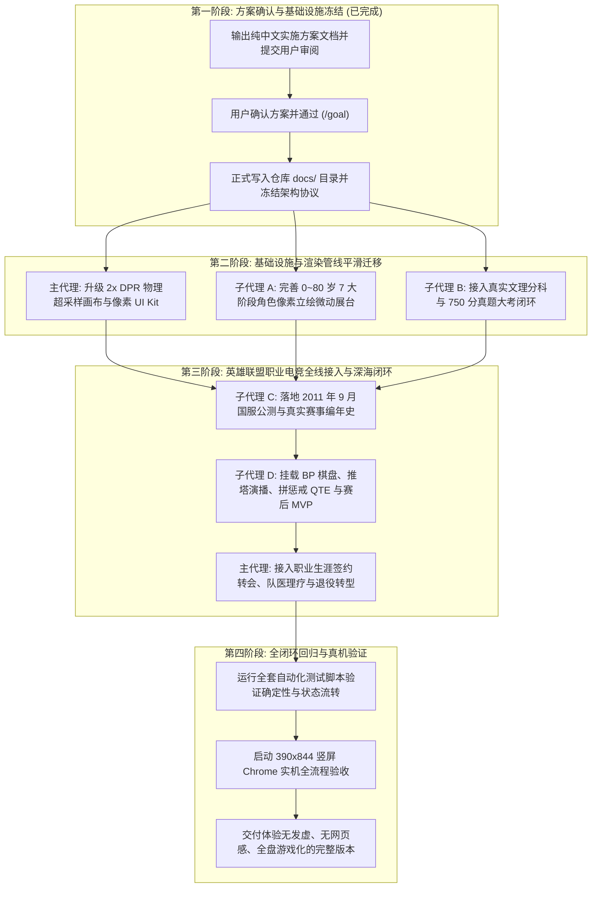

# 《1978—一生》游戏引擎全盘架构重构与英雄联盟职业路线深化方案

> **文件属性**：架构重构与系统落地全局方案（用户已确认并生效）  
> **核心原则**：以“真正的 2D 游戏引擎架构”彻底取代“网页鼠标点点点”，全盘推进复古像素画质、全年龄角色立绘、严肃文理高考与英雄联盟职业电竞深海闭环。

---

## 一、方案背景与核心痛点诊断

在项目当前的运行形态中，存在让玩家严重出戏的系统级硬伤。用户提出的批评切中本质：
1. **“游戏引擎都没用上，这就拿鼠标点点点”**：虽然引入了 Phaser 依赖，但代码本质上是在单体上万行文件中堆砌 `add.text()` 和矩形色块，把游戏做成了类似 HTML 表单、网页弹窗的“网页填表模拟器”。缺乏多 Scene 场景管理、主相机动态、粒子氛围、角色行动微动与即时操作反馈；
2. **“画面和字体发虚模糊”**：Canvas 采用 390×844 的 CSS 逻辑分辨率直接绘制并拉伸，未做 DPR（设备像素比）超采样适配，高分屏下字符边缘发毛、像素线条虚化；
3. **“高考题目乱给不分科，题目大杂烩”**：题库充斥网络段子烂梗，脱离中国真实高考历史（文理不分、分值失真、没有真实省排位与梯度志愿录取）；
4. **“缺乏角色形象与游戏代入感”**：主角仅是一串名字与数值属性，在长达几十年的岁月中毫无形象演进；
5. **“不仅局限于电竞单点，整个游戏架构要好好改进重构”**：必须立足全局，将底层的游戏引擎管线、画质、场景调度、视觉立绘、高考学业、职业路线（重点深耕 LOL）统一纳入系统化架构中，而非只修补电竞一个点。

根据用户明确指定的四项决策基准：
- **1 为 A（复古像素风格）**：类似《中国式人生》经典像素质感、立体 UI、微动动画；
- **2 为 按照实际的来即可**：高考真实文理分科（物化生 vs 史地政），满分 750 分真题大考；
- **3 为 C（全面重启架构）**：彻底推翻网页式单体逻辑，搭建现代 Phaser 2D 游戏引擎架构体系；
- **4 为 需要全年龄角色立绘状态机**：0~80 岁 7 大人生阶段动态立绘展台；
- **核心重点职业线**：英雄联盟（LOL）职业电竞路线，严格对齐 2011 年 9 月国服公测时间线与真实赛事赛制。

---

## 二、全盘游戏引擎架构重构方案（彻底告别网页感）

### 1. 多 Scene 并行分层游戏引擎架构

告别“所有逻辑硬堆在单一 Scene 中用布尔值显示/隐藏容器”的伪游戏做法，采用标准的 Phaser 多 Scene 并行流水线架构：



- **`WorldStageScene` (背景与时代生活舞台，Depth: 0)**：
  - 动态渲染当前年代与所在城市的 2D 像素街景（从 80 年代青砖筒子楼、二八大杠，到 90 年代霓虹街市，再到千禧年后现代高楼）；
  - 角色在场景中进行自主生活动作微演播（散步、伏案写字、与家人互动、骑车）；
  - 昼夜环境光变换与四季粒子效果（春雨淅沥、夏日蝉鸣金光、秋风落叶、冬日飞雪）。
- **`ActionStageScene` (生活行动舞台，Depth: 10)**：
  - **彻底告别网页点击列表**：将生活行动设计为可拖拽/轻触选中的**像素立体行动卡牌**；
  - 选定行动（如“去网吧包夜练补刀”、“参加数学奥赛培优”、“向心仪同桌递纸条”）后，屏幕中央触发 1.2 秒的**即时 2D 像素动作短演播与数值飘字**，立即获得正向反馈。
- **`GameHudScene` (常驻游戏 HUD，Depth: 20)**：
  - 顶部角色核心仪表盘（智商、情商、体魄、魅力、声望、家庭资产）；
  - 底部模块化 Dock 导航栏（【生活】、【关系】、【发展/学业与职业】、【资产】、【活动】）；
  - 按钮具有真实的物理按压感（按下位移 2px、高光边缘变化、点击微回弹、伴随 8-bit 复古按键音效）。
- **`SeasonAdvanceDirector` (季度/年度推进心跳导演管线)**：
  - 玩家点击“进入下一季/下一年”后，**绝对不突兀刷新网页**，而是触发约 2 秒的影视级季度过渡演播：
    1. 画面平滑淡入半透明时代遮罩，中央日历牌以翻页动效流转；
    2. 伴随齿轮转动与钟表滴答声，季节色调流动；
    3. 角色立绘展台伴随成长光效，属性变动数值如雨后春笋般浮升；
    4. 季度重大新闻与时代变迁简报以打字机动效划过屏幕。

---

## 三、2x 视网膜物理高清渲染与复古像素 UI Kit

### 1. 根治字体发虚与画面模糊的 HiDPI 超采样管线

针对高分屏下 Canvas 被浏览器插值拉伸导致模糊发虚的问题，部署全链路 2x DPR 物理超采样：


- **画布与渲染器核心配置**：
  - 画布物理尺寸：`780 × 1688`（严谨对应 390×844 的两倍物理像素）；
  - `pixelArt: true`：关闭平滑双线性插值，杜绝模糊涂抹；
  - `antialias: false`：保留硬朗纯正的像素边缘；
  - `roundPixels: true`：所有顶点坐标强制整数对齐，彻底消灭“半像素引起的文字发虚与线条抖动”；
  - 全局配置统一的像素等宽中文字体（如 `fusion-pixel` / `'Press Start 2P', 'PingFang SC', sans-serif`），标题与数值文字采用 Canvas 2x 离屏位图生成。

### 2. 纯 Phaser 打造的复古像素 UI Kit

彻底淘汰原生 HTML DOM 元素，所有界面组件由 Phaser 原生绘制：
- **`PixelPanel` (九宫格复古像素面板)**：
  - 支持深色胡桃木边框、复古金属黄铜角花、羊皮纸米白内衬三种主题风格；
  - 纯 Canvas Procedural Graphics 绘制，支持任意尺寸拉伸且边角绝不失真。
- **`PixelButton` (立体按压反馈按钮)**：
  - 具备常规状态、高光描边状态、按下凹陷 2~4px 状态与禁用置灰状态；
  - 自带触觉反馈震动 API（移动端支持）与 8-bit 点击音效。
- **`FloatingFeedback` (数值变动浮动数字系统)**：
  - 属性提升：绿色加粗数字跳跃浮升伴随金色微光（`智力 +5 ⬆`）；
  - 属性下降/疲劳增加：红色数字下沉渐隐（`健康 -3 ⬇`、`压力 +8`）；
  - 关键成就：金色大号横幅与彩带喷射。

---

## 四、全年龄角色像素动态立绘状态机系统

彻底消灭“只有文字名字”的冰冷感，主界面核心黄金位置设立**全年龄段角色像素动态展台 (`CharacterStageWidget`)**：



### 7 大人生阶段像素立绘与动态特征

| 年龄阶段 | 时代服装与视觉符号 | 待机与环境动态动画 | 情绪与事件状态响应 |
| :--- | :--- | :--- | :--- |
| **0~3岁 幼童期** | 手工红肚兜、虎头帽、虎头鞋、纯棉襁褓 | 怀抱拨浪鼓轻摇、眨眼呼吸微动、地面爬行抓玩 | 生病发烧脸颊通红带眼泪、抓周拿到电脑芯片开怀大笑 |
| **4~6岁 启蒙期** | 红星海魂衫、蓝色短裤、军绿色小帆布斜挎包 | 踩影子、手中竹蜻蜓旋转、舔老冰棍轻微摇晃 | 拍洋画赢了举手欢呼、被大鹅追赶慌张奔跑 |
| **7~12岁 小学期** | 鲜艳红领巾、双排扣浅灰校服、双肩书包 | 端坐课桌前举手、课间跳皮筋、背书包招手 | 戴上“三道杠”昂首挺胸胸前发光、没写作业抓耳挠腮 |
| **13~18岁 中学期** | 宽大蓝白条纹运动校服、回力球鞋、随身听耳机 | 课桌伏案疾书、课间篮球运球投篮、塞耳机听磁带 | 高考备考咬笔头沉思、网吧包夜下眼睑显现黑眼圈 |
| **18~24岁 电竞黄金期** | 职业俱乐部定制刺绣战袍、竞技降噪耳机、护腕 | 机械键盘光速敲击残影、胸前战队队徽微弱光芒流动 | 登上万众瞩目赛场眼神凌厉、夺得世界冠军满场金色雨落下 |
| **25~50岁 职场/教练期** | 笔挺商务西服/战术指挥夹克、腕表、手持战术板 | 翻阅数据战报文件、战术板白板笔圈点、端咖啡沉思 | 战术得当握拳振奋、遭遇连败捏眉心抗压复盘 |
| **50岁以上 退休名宿期** | 复古中式开衫毛衣、老花镜、保温杯、太极晨练服 | 树荫石桌对弈、修剪迎客松盆栽、翻阅年轻时的奖杯相册 | 慈祥含饴弄孙微笑点头、看着新一代年轻人意气风发 |

- **角色互动反馈**：玩家点击角色展台，角色会根据当前性格与心境做出专属反应动效（如电竞期快速敲击两下键盘比出胜利手势，头顶弹出当前心声：“这把排位我必吃分！”）。

---

## 五、遵循历史真实的高考文理分科与学业体系

彻底摒弃网络烂梗与无厘头选择，按照中国真实教育史与学术考核落地：



### 1. 真实文理分科考量
- **理科班（物化生）**：
  - 学习特点：对逻辑推理、抽象空间想象与快速反应要求极高；
  - 对后续路线影响：为【职业电竞（微操手速与大局算计）】、【软件工程/互联网科技】、【科研学者】提供核心智力与反应加成。
- **文科班（史地政）**：
  - 学习特点：注重历史宏观大局观、文字表达与政策敏锐度；
  - 对后续路线影响：为【经管金融】、【传媒解说/战术教练】、【法学公职】提供极高情商与声望加成。

### 2. 严谨真题库建设（100% 拒绝网络段子）
- **语文（150分）**：苏轼《赤壁赋》名句默写、荀子《劝学》实词辨析、高中典型病句辨析（成分残缺/句式杂糅）；
- **数学（150分）**：三角恒等变换、立体几何线面垂直证明、文科/理科导数切线与单调性讨论；
- **英语（150分）**：核心词汇辨析、非谓语动词运用、虚拟语气与经典短文改错；
- **理科综合（300分）**：
  - 物理：牛顿第二定律与传送带动力学模型、带电粒子在匀强磁场中的洛伦兹力偏转；
  - 化学：阿伏加德罗常数（$N_A$）正误辨析、原电池与电解池电极反应式书写；
  - 生物：孟德尔分离定律与自由组合概率计算、神经元兴奋传导方向。
- **文科综合（300分）**：
  - 历史：商鞅变法与中央集权制度确立、辛亥革命与新文化运动、十一届三中全会与改革开放新时期；
  - 政治：价值规律与市场供求机制、我国根本政治制度（人民代表大会制度）、唯物辩证法矛盾分析法；
  - 地理：地方时与经纬度换算、季风环流与全球气候带分布、喀斯特地貌与水土流失成因。

### 3. 全省位次与高校录取梯队
- 考分结合玩家在校平时知识积累（70%）与高考答题临场表现（30%）合成真实分数（满分 750 分）；
- 依据全省数十万考生正态分布模型生成省排位（如“全省第 128 名”或“全省第 34,500 名”）；
- 梯度录取通知书系统：
  - **超一流顶尖名校**：清华大学、北京大学（全省前 100~200 名）；
  - **华东五校 / C9 联盟**：复旦、上交、浙大、中科大、南大；
  - **985 / 211 重点大学**：全国重点知名高校；
  - **普通公办一本 / 二本**；
  - **高职专科 / 落榜复读**。
- 放榜时以全屏红金印章通知书展开，带给玩家极致的仪式感。

---

## 六、英雄联盟（LOL）职业路线深度对齐与游戏化落地方案

### 1. 严格对齐真实历史编年史（解决公测与时间线脱节）

职业电竞路线必须严格锚定真实世界的时间节点，杜绝时间线混乱：



### 2. 职业生涯六步阶梯体系



### 3. 游戏化的沉浸式比赛切面（BP + 推塔演播 + 拼惩戒 QTE + MVP 结算）

**彻底淘汰网页文字弹窗**，打造纯 Phaser 渲染的像素对战切面：
1. **战术 BP 棋盘博弈 (`EsportsBpBoard`)**：
   - 红蓝方选边博弈：蓝方抢版本强势 T0，红方拿第五手 Counter 康特位；
   - 战术体系克制：强开冲脸流 > 四一分推流 > 阵地团控流 > 消耗 Poke 流；
   - 锁下绝活英雄：立绘发光并发出专属语音台词与技能音效。
2. **三路推塔动态演播 (`EsportsMatchView`)**：
   - 上中下三路外塔、内塔、高地塔、门牙塔的耐久度像素动态进度条；
   - 队伍实时经济差曲线走势图；
   - 精彩击杀与关键团战小人技能对轰微动画。
3. **龙坑抢大龙拼惩戒 QTE (`EsportsQteSmite`)**：
   - 决胜关键局触发“纳什男爵残血（血量 900 倒计时）”；
   - 屏幕中央出现动态收缩光圈，玩家需在光圈恰好收缩至内圈圆心的瞬间按下【惩戒/SPACE】；
   - 玩家的微操 APM、即时反应速度与临场抗压数值决定光圈速度与判定区间；
   - 成功触发“逆天抢龙并团灭对手”超绝音效；失败则面临大龙被抢的巨大危机。
4. **赛后结算与 MVP 荣誉徽章 (`EsportsSettlementModal`)**：
   - 动态展示双方五人 KDA、参团率、全场伤害占比柱状图；
   - 评选全场 MVP 选手，颁发镀金勋章；
   - 结算本场俱乐部积分、选手身价增长、粉丝增减与奖金分成。

---

## 七、工程代码全面解耦与重构目录结构

彻底终结单体 `life-scene.ts`（原近 10,000 行），全面按照职责单一原则进行模块化重构：

```text
apps/game/src/
├── main.ts                       # 引擎启动入口，配置 780x1688 (2x DPR) 超采样画布
├── core/                         # 核心桥接网关 (纯 TS 逻辑，不直接碰 DOM)
│   ├── game-bridge.ts            # 与模拟层核心 (simulation/) 确定性快照同步
│   └── sound-manager.ts          # 8-bit/16-bit 像素音效与复古背景音轨管理器
├── ui-kit/                       # 复古像素 UI 基础组件库
│   ├── pixel-palette.ts          # 统一像素色板 (羊皮纸白、青铜绿、帝王金、胡桃木)
│   ├── pixel-panel.ts            # 九宫格自适应像素木纹/金属边框面板
│   ├── pixel-button.ts           # 2px 下沉按压反馈立体按钮
│   └── floating-text.ts          # 属性变动跳跃飘字反馈系统
├── views/                        # 主界面常驻组件与展台
│   ├── character-avatar-stage.ts # 0~80岁 7 大阶段像素动态立绘与微动动画
│   ├── character-stage-widget.ts # 主界面常驻角色展台 (底座/铭牌/心声/飘字接收器)
│   ├── game-dock-nav.ts          # 底部像素 Dock 导航栏
│   └── status-header-bar.ts      # 顶部六维属性与金钱常驻状态条
├── education/                    # 高中与高考独立模块
│   ├── gaokao-contracts.ts       # 文理分科、满分750分各科数据模型
│   ├── gaokao-question-bank.ts   # 真实高中学术真题库 (拒绝烂梗)
│   ├── gaokao-engine.ts          # 考试出卷、平时与临场算分、全省排位与高校梯度
│   └── ui/
│       └── gaokao-modal.ts       # 沉浸式高考考场答题与录取通知书展开切面
├── esports/                      # 英雄联盟职业电竞系统 (高内聚独立体系)
│   ├── esports-contracts.ts      # 2011~2024 历年赛季、六维微操指标、阶梯合同
│   ├── lol-historical-timeline.ts# 真实历史编年史 (2011公测、LPL创立、S8夺冠、瑞士轮)
│   ├── esports-league-engine.ts  # 双循环常规赛、双败季后赛、S赛瑞士轮引擎
│   ├── esports-contracts-system.ts# 青训/新秀/主力/顶薪合同签约与转会算法
│   ├── lol-career-manager.ts     # 职业生涯状态机 (排位训练/队医理疗/正式比赛/转会)
│   └── ui/
│       ├── esports-bp-board.ts   # 战术 BP 棋盘博弈组件
│       ├── esports-match-view.ts # 三路推塔与对战演播切面
│       ├── esports-qte-smite.ts  # 龙坑拼惩戒收缩光圈 QTE 互动组件
│       └── esports-settlement-modal.ts # 赛后 MVP、伤害占比与荣誉结算面板
└── screens/                      # 轻量化 Scene 控制器
    ├── boot-scene.ts             # 画布初始化与着色器加载
    ├── life-scene.ts             # 瘦身为主控制器 (仅协调各模块调度，约 400 行)
    └── advance-director.ts       # 季度/年度推进演播导演管线
```

---

## 八、实施落地路线图与多代理协同计划

严格遵循用户的最高铁律，采用多代理并发执行：



---

## 九、总结与决策确认项

本方案已彻底厘清用户的真正诉求：
1. **不仅是修电竞一个功能**，而是借此契机完成**整个游戏向真正 Phaser 2D 游戏引擎的脱胎换骨式重构**；
2. **彻底消灭“网页点击表单感”与“画面字体发虚”**，全面确立 **A. 复古像素风 + 2x 物理超采样 + 纯 Phaser UI Kit**；
3. **彻底规范高考学业体系**，确立 **历史真实文理分科 + 750 分真题学术考卷 + 全省位次与高校阶梯录取**；
4. **全面落地角色视觉代入感**，确立 **0~80 岁 7 大人生阶段动态立绘状态机展台**；
5. **电竞路线重点深耕英雄联盟（LOL）**，严格锚定 **2011 年 9 月国服公测**，覆盖完整职业生涯六步阶梯、四级合同、真实历史赛制演进与游戏化比赛切面（BP + 推塔 + QTE + MVP）。
