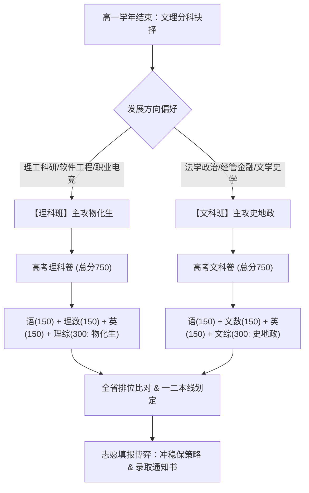
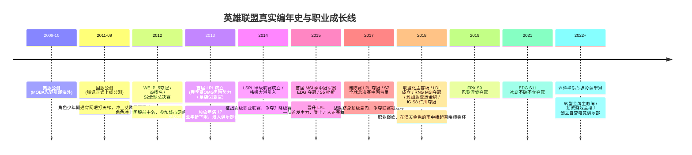

# 《1978—一生》游戏全面重构与英雄联盟职业路线实施方案

## 一、方案背景与核心宗旨

针对当前版本存在的四大核心问题：
1. **画面与文字模糊**：Canvas 采用 390×844 的 CSS 逻辑分辨率直接拉伸显示，未做 DPR 物理超采样适配，导致高分屏与桌面端发虚；
2. **缺乏游戏感**：本质上是用 Phaser 的 `scene.add.text()` 和 `fillRoundedRect()` 堆砌的网页文字表单，缺少角色立绘、像素动态表现、场景层级、音效节拍与即时操作反馈；
3. **高考大杂烩不分科**：题库以网络段子梗题为主，未按中国真实教育历史演进划分文理分科与真实学术考核；
4. **单文件代码腐烂**：`life-scene.ts` 超过 10,000 行，业务逻辑、静态资产数据与渲染代码高度耦合。

本方案按照用户明确确认的四大决策全面启动重构：
- **画风**：**A. 像素复古风**（类似《中国式人生》经典清爽像素卡通风格）；
- **高考制度**：**按历史真实演进落地**（1978~1993 旧统考、1994~1999 真实“3+2”语数英+文/理、2000 后的 3+X 大综合）；
- **重构策略**：**C. 全面重启**，从底层画质管线与组件化架构彻底重写；
- **视觉角色**：**全年龄段像素立绘状态机**（从婴儿到老年）；
- **核心重点路线**：**英雄联盟（LOL）职业电竞路线**，严格按照 2009~2024 年国服公测、赛事创建、真实俱乐部与赛制规则深度闭环。

---

## 二、底层渲染与画质重构方案（根治模糊）

### 1. 2x 物理像素超采样管线 (HiDPI / Retina Pipeline)


- **物理像素尺寸**：从 `390 × 844` 升级为 **`780 × 1688`**（2x 物理超采样），CSS 样式限制显示为 `390 × 844`；
- **渲染器配置**：
  - `antialias: false`（关闭模糊的平滑抗锯齿，保留清晰硬朗的像素边缘）；
  - `pixelArt: true`（启用像素艺术模式）；
  - `roundPixels: true`（所有坐标绘制强制整数对齐，杜绝半像素发虚）；
  - `resolution: 1`（在 780×1688 原生物理高分画布上精确 1:1 绘制）。

### 2. 复古像素 UI Kit 资产规范
- **九宫格切片（9-Slice Scaling）**：制作具有复古红白机/DOS 时代特色的木纹框、金属铜边框与牛皮纸底色对话框；
- **按键微动反馈**：所有按钮具备按下凹陷、高光边缘变化与 8-bit 复古点击音效；
- **数值浮动动效（Floating Feedback）**：属性变动时采用上升淡出浮动数字（如 `智力 +5 ⬆` 翠绿跳跃、`疲劳 +10 ⬇` 绯红下沉）。

---

## 三、全年龄角色像素立绘与状态机系统

彻底告别“只有名字字符串”的网页体验，主界面设立常驻**角色动态像素展台**：

| 年龄阶段 | 时代服饰与外貌特征 | 像素动作与待机状态 | 交互与状态反馈 |
| :--- | :--- | :--- | :--- |
| **0~3岁 幼童期** | 襁褓被褥、红肚兜、手工虎头鞋 | 爬行抓玩、周岁抓周动作 | 生病发热面颊泛红、大哭大笑 |
| **4~6岁 启蒙期** | 帆布小挎包、红星海魂衫、短裤 | 跳格子、竹蜻蜓盘旋、吃雪糕 | 拍画片赢牌得意、摔倒抹眼泪 |
| **7~12岁 小学期** | 鲜艳红领巾、三道杠大队长、双排扣校服 | 背书包招手、举手抢答、跳皮筋 | 考满分佩戴大红花、写作业犯困 |
| **13~18岁 中学期** | 宽大蓝白运动校服、帆布球鞋、随身听耳机 | 伏案刷题、课间打篮球投篮 | 备考紧张咬铅笔、网吧包夜黑眼圈 |
| **18~24岁 电竞期** | 职业战队定制战袍队服、防蓝光眼镜、降噪耳机 | 键盘光速敲击残影、战队徽标胸前闪耀 | 登台举杯金色彩带、赛后复盘握腕揉肩 |
| **25~50岁 职场期** | 商务西装、夹克衬衫、战队主教练战术板 | 战术板划线指点、公文包阅读文件 | 意气风发指挥赛训、商务谈判沉稳从容 |
| **50岁以上 中老年期** | 休闲毛衣、老花镜、保温杯、太极晨练服 | 树荫对弈、修剪盆栽、翻阅生涯荣誉相册 | 慈祥含饴弄孙、安详回望波澜壮阔一生 |

---

## 四、遵循真实历史的高考文理分科系统

### 1. 年代高考考制演进对照



- **1978~1993 年**：文理分科单科独立计分统考；
- **1994~1999 年**：标准 **“3+2” 考制**（语数英 3 门必考 + 理科考物理、化学 / 文科考政治、历史）；
- **2000 年后**：全国推广 **“3+X” 综合模式**（文科综合 / 理科综合，满分统一为 750 分）。

### 2. 学科题库真题化设计（拒绝烂梗，回归学术与时代挑战）
- **通用必考科目**：
  - **语文 (150分)**：名篇名句默写（《逍遥游》《师说》《琵琶行》）、文言实词推断、现代文逻辑论证；
  - **数学 (150分)**：区分文科数学与理科数学难度，包含三角恒等变换、立体几何线面垂直、圆锥曲线联立、导数单调性；
  - **英语 (150分)**：高考核心词汇辨析、经典短文改错时态语态、阅读理解长难句主旨；
- **理科综合卷 (300分)**：
  - **物理**：牛顿第二定律与传送带模型、带电粒子在复合场中圆周运动、电磁感应切割磁感线；
  - **化学**：阿伏加德罗常数正误辨析、原电池与电解池电极反应式、有机官能团逆合成推导；
  - **生物**：伴性遗传概率计算、光合速率与呼吸速率测定、兴奋在神经纤维上的双向与单向传导；
- **文科综合卷 (300分)**：
  - **历史**：商鞅变法与郡县制演进、辛亥革命与新文化运动思想解放、十一届三中全会与对外开放格局；
  - **政治**：价值规律与商品供求关系、人民代表大会制度核心职能、唯物史观与矛盾普遍性与特殊性；
  - **地理**：经纬网与地方时计算、气压带风带与气候特征、黄土高原水土流失成因与综合治理。

### 3. 高校梯队与志愿录取
- **高校梯度划分**：C9 顶尖联盟（清华、北大、华五） $\rightarrow$ 985 顶尖名校 $\rightarrow$ 211 重点大学 $\rightarrow$ 普通公办一本 $\rightarrow$ 地方公立本科 $\rightarrow$ 专科高职；
- **录取逻辑**：全省总分排位计算位次，模拟考填报“冲、稳、保”三档志愿，存在名校滑档降档、专业调剂录取机制。

---

## 五、英雄联盟（LOL）职业路线深度落地规范（对齐真实时间线）

### 1. 真实历史编年史时间轴



### 2. 真实晋级路线六步法

1. **网吧争霸赛与艾欧尼亚路人王（15~16岁 · 2011~2012）**：
   - 时代地点：在街机网吧包夜，练习招牌绝活英雄（盲僧、劫、暗夜猎手）；
   - 天梯排位：电信一区冲上大师/最强王者，收到各大俱乐部星探私信；
   - 家庭冲突：父母“打游戏能当饭吃？”的强烈反对与签署“一年之约协议书”。
2. **俱乐部基地青训营选拔 Tryout（16~17岁 · 2013）**：
   - 入驻上海电竞基地地下室，学徒月薪 4,000~8,000 元包吃住；
   - 面对 90% 淘汰率的残酷训练赛与高压作息；
   - 年满 17 岁达到联盟参赛最低年龄，正式签约新秀合同。
3. **次级职业联赛打拼（2014~2017 LSPL / 2018 起 LDL）**：
   - 乘坐大巴奔赴线下副场馆，打满常规赛循环；
   - 经历残酷的升降级保级生死局；
   - 获得次级联赛 MVP，触发一队主教练提拔与续约。
4. **顶级职业联赛 LPL 正式首发（18~23岁黄金期）**：
   - 首登主舞台，面对全场观众与解说，克服开场手抖；
   - 面对真实豪门强队（EDG, RNG, iG, WE, OMG, TES, JDG, BLG, WBG）；
   - 春季赛/夏季赛常规赛大组循环，季后赛双败淘汰制角逐银龙杯；
   - 签署千万级年薪明星合同，代言外设与俱乐部周边。
5. **国际大赛征程（MSI 季中赛 & S 赛全球总决赛）**：
   - 跨国征战（欧美、日韩、冰岛），克服倒时差与水土不服；
   - S 赛真实赛制演进（经典小组赛 $\rightarrow$ 2023 起的瑞士轮 3胜晋级/3败淘汰）；
   - 淘汰赛 BO5 生死局，战歌响起，决胜时刻五杀封神，捧起世界冠军金杯与纯金冠军戒指。
6. **老将退役与人生下半场转型（24岁+）**：
   - 生理微操 APM 与反应延时自然下滑，遭受腕管综合征与颈椎病困扰；
   - 选择打封闭针坚持征战或举办退役告别仪式；
   - 三大转型路径：
     - **金牌战术主教练**：负责赛前战术 BP、赛训复盘与临场指挥；
     - **顶流电竞主播**：入驻大直播平台，解说官方赛事，粉丝打赏日进斗金；
     - **电竞俱乐部老板**：斥资建立自营新军俱乐部，培养新一代青训苗子。

### 3. 像素级赛事对决玩法设计

彻底淘汰纯文字弹窗，引入**沉浸式像素比赛对决切面**：
- **战术 BP 棋盘博弈**：
  - 蓝方先选抢版本 T0，红方握有最后一手 Counter 康特位；
  - 阵型风格克制：强开冲脸流 > 四一分推流 > 阵地团控流 > 强开冲脸流；
  - 锁下招牌绝活英雄，触发专属像素英雄立绘与炫目金光；
- **战况动态微演播**：
  - 三路推塔动态进度条与队伍经济差曲线；
  - 关键时刻触发 **QTE 反应点击**（如龙坑抢大龙拼惩戒：在动态光圈缩至圆心瞬间按下快捷键，手速决定控龙成败）；
  - 决胜时刻像素小人五杀走位特写与水晶枢纽爆裂碎片动画。

---

## 六、工程重构与代码解耦目录规范

将当前 10,191 行的单体 `life-scene.ts` 全面拆分，彻底清除死代码与静态硬编码：

```text
apps/game/src/
├── main.ts                    # 引擎主入口，配置 780x1688 (2x DPR) 高清画布
├── runtime/                   # 确定性核心桥接网关，纯逻辑不读写 DOM
├── screens/
│   ├── life-scene.ts          # 轻量场景总调度器 (仅约 300 行)
│   ├── boot-scene.ts          # 资源预加载与首屏配置
│   └── birth-scene.ts         # 像素复古版抓周与创角流程
├── views/                     # 5 大全景独立切页组件
│   ├── home-view.ts           # 【主页】常驻角色立绘展台、信笺流、下一年推进
│   ├── relations-view.ts      # 【关系】人际像素立绘网格、亲密互动
│   ├── locations-view.ts      # 【活动】时代城镇建筑场景、行动选择
│   ├── development-view.ts    # 【发展】学业/职场双切页、雷达图看板
│   └── assets-view.ts         # 【资产】老物件博物馆、房产座驾
├── esports/                   # 电竞系统独立模块
│   ├── esports-engine.ts      # 联赛积分、双败赛制、瑞士轮与退役算法
│   ├── esports-database.ts    # 历年豪门战队、赛制变迁、签约薪资
│   ├── esports-events.ts      # 2009~2024 真实电竞编年史事件
│   └── ui/
│       ├── esports-dashboard.ts # 职业战队展台看板
│       ├── esports-bp-modal.ts  # 战术 BP 交互棋盘
│       └── esports-match-live.ts# 比赛像素战况与QTE抢龙互动
├── education/                 # 真实高考与教育系统
│   ├── gaokao-engine.ts       # 文理分科、满分750分算分与志愿录取模型
│   ├── gaokao-question-bank.ts# 真实高中学科真题库 (拒绝网络段子)
│   └── ui/
│       ├── stream-select-modal.ts # 高二文理分科仪式弹窗
│       └── gaokao-exam-modal.ts   # 分科答题、放榜与录取通知书
├── ui-kit/                    # 像素基础组件库
│   ├── pixel-panel.ts         # 九宫格像素面板、复古边框
│   ├── pixel-button.ts        # 按压回弹与音效按键
│   ├── floating-text.ts       # 属性变动浮动数字
│   └── audio-manager.ts       # 8-bit 复古合成音效管理器
└── data/                      # 纯静态 JSON/TS 数据字典
```

---

## 七、四阶段实施计划与验收门槛

| 阶段 | 核心任务 | 交付物与产出 | 验收门槛 |
| :--- | :--- | :--- | :--- |
| **第一阶段** | 画质高清化与架构解耦 | 780×1688 高清画布上线；拆分 10191 行单文件为轻量场景与独立 Views | 桌面与手机端字迹边缘极度锐利，0 模糊；类型检查 0 报错 |
| **第二阶段** | 像素立绘与动态展台 | 挂载 0~80 岁各阶段像素立绘；主界面实时呈现角色外貌、服饰与动作反馈 | 主页直观看见立绘变化，行动有音效与数字飘字 |
| **第三阶段** | 真实高考文理分科系统 | 高二文理分科仪式；文理综合真题卷；750 分算分、位次排位与大学录取通知书 | 高中阶段正确分科，各科题目符合高中学术标准，录取逻辑真实 |
| **第四阶段** | LOL 真实职业全链路落地 | 2011~2024 编年史、网吧赛、青训、次级LSPL/LDL、顶级LPL、S赛瑞士轮、BP棋盘、抢龙QTE | 完整走通电竞生涯全阶段，各赛制与年份严丝合缝对齐真实历史 |

---

## 八、总结说明

本方案以“还原真实人生、强化游戏乐趣、告别网页表单排版”为唯一准绳。获得确认后将严格按上述四阶段次序有条不紊推进落地。
